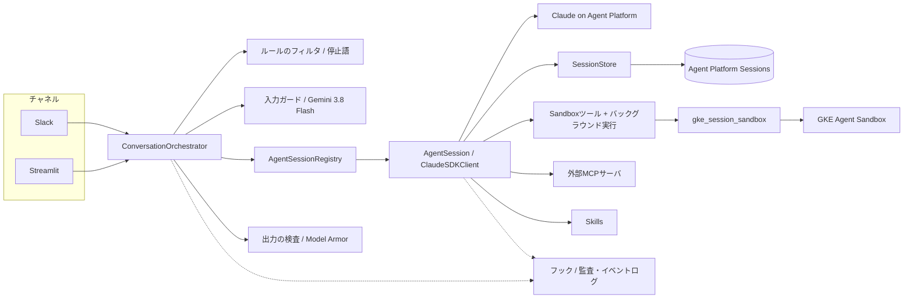

# silk-agent

Slackから指示を受けて作業するエージェントのBot。Claude Agent SDKのエージェントが、**会話ごとに用意されるGKE Agent Sandbox上の作業環境**でコマンドの実行やファイルの読み書きを行う。

- エージェント: Claude Agent SDK + Agent Platform（旧Vertex AI）上のClaude
- 作業環境: GKE Agent Sandbox（gVisor）。Sandboxの作成・停止・再開・削除とコマンド実行は、同梱のライブラリ`gke_session_sandbox`（`src/gke_session_sandbox`、説明は[docs/gke-session-sandbox/README.md](docs/gke-session-sandbox/README.md)）が行う
- 会話の保存: Agent Platform Sessions
- 入出力の検査: Gemini 3.8 Flash（入力）、Model Armor（出力）
- 動作環境: GKE上の1 Pod（Slack Socket Mode）。開発用にStreamlitのチャット画面もある
- ユースケースごとのプロンプト・Skills・フック・Sandboxイメージ・設定は、本体を変更せずに別パッケージとして用意できる（[docs/usecase-guide.md](docs/usecase-guide.md)、テンプレートは`usecases/template/`）

## 1. Slackでの使い方

### 1.1 話しかける

- チャンネルでBotをメンションすると、そのメッセージのスレッドが1つの会話になる。以後、そのスレッドへの返信は（メンションなしでも）同じ会話として扱う。
- DMでも話しかけられる。
- 会話ごとに専用の作業環境（Sandbox）が作られる。別のスレッドからは、ほかの会話のファイルは見えない。

### 1.2 進捗メッセージ

1回の依頼（turn）ごとに、スレッドへ進捗メッセージを1つ投稿し、処理の間は書き換え続ける。エージェントの返答は別のメッセージとして投稿する。

```text
⏳ 実行中（経過 4分）　最終更新 2026-10-11 12:04
✅ 成功 bash git clone https://github.com/...（3秒）
✅ 成功 read_file src/app.py（0秒）
🔄 バックグラウンドで実行中 bash uv run pytest（20秒）
⏳ 実行中 bash uv run ruff check .
📝 追加の指示 1件（実行中のツールが終わったら、この処理の続きで対応します）
停止するには『停止』と書き込んでください
```

| 表示 | 意味 |
| --- | --- |
| 🛠 作業環境を起動しています… | Sandboxを作成・再開している（新規作成は約25秒）。Sandboxが動いていれば出ない |
| ⏳ 実行中 / ✅ 完了 / ❌ 失敗 | turnの状態。完了時は所要時間、ツールの回数、費用を出す |
| ツールの一覧 | ⏳ 実行中 / ✅ 成功 / ❌ 失敗 / ⏹ 中断 / 🔄 バックグラウンドで実行中。最新20件を表示し、残りは件数だけ出す |
| 最終更新 YYYY-MM-DD HH:MM | 実行中は1分ごとに更新する（Asia/Tokyo）。**時刻が進まなくなったらBotが止まっている** |
| 📝 追加の指示 N件 | 実行中に書き込まれた指示を、今の処理に追加したこと |

ツールの要約やエージェントの返答は、表示する前にModel Armorで検査する（§3.3）。12,000文字を超える返答はファイルとしてアップロードする。

### 1.3 実行中に追加で指示する

処理の途中にスレッドへ書き込んだ指示は、**今の処理を止めずに追加**される。エージェントは実行中のツールが終わったところでそれを読み、同じ処理の続きで対応する。1つの会話でエージェントが二重に動くことはない。

### 1.4 時間のかかるコマンド（バックグラウンド実行）

- `bash`は20秒だけ完了を待ち、終わらなければバックグラウンド実行に切り替える。エージェントは「バックグラウンドで実行中（command_id）」と伝えて処理を終えるので、その間も次の指示を出せる。
- コマンドが終わると、その結果（終了コード、出力の末尾）が会話に通知され、エージェントが報告する。処理中ならその処理に追加され、待機中なら新しい処理として始まる。
- 複数のコマンドを並行して動かせる。上限時間は既定1時間。

### 1.5 止める

メッセージ全体が「**停止**」「**中止**」「**中断**」「**STOP**」のいずれかなら、実行中の処理とバックグラウンドのコマンドを止める。

- 前後の空白、全角・半角、英字の大文字・小文字の違いは無視する（「 ｓｔｏｐ 」も停止）。
- 「処理を停止して別のことをして」のように他の文字を含む場合は、停止せず通常の指示として扱う。
- 何も動いていなければ「実行中の処理はありません。」と返す。

### 1.6 Botが止まったとき

- 処理中にBotが落ちると、進捗メッセージの「最終更新」が進まなくなる。
- Botが再び起動すると、中断した処理の進捗メッセージを「⚠️ Botの停止により中断（最終更新 …）」（正常終了で止めた場合は、止めた時点で「⚠️ Botの再起動により中断」）に書き換え、スレッドに再開方法を投稿する。
- 「続けて」と書くと、会話の内容を引き継いで再開する。中断時に動いていたコマンドは、再実行せずに状態を確認してから続ける。自動では再開しない（副作用のある処理を二重に実行しないため）。
- 作業ファイルはSandboxに残っている。

## 2. 構成



1. チャネル（Slack / Streamlit）が受け取ったメッセージを、チャネルに依存しないイベントに変換する。
2. ルールのフィルタで対象外を除き（Bot自身やほかのBotの投稿、許可外のワークスペース・チャンネル・ユーザ、DM・ゲスト・外部ユーザ（設定したとき）、長すぎるメッセージ、送信頻度）、停止語ならここで止める。
3. Gemini 3.8 Flashで、指示違反（システム指示の上書き要求、認証情報の取得要求など）がないか判定する。
4. 会話ごとの`AgentSession`へ渡す。実行中ならその処理に追加し、そうでなければ新しいturnを始める。
5. エージェントの返答とツールの実行状況を、Model Armorで検査してからチャネルへ送る。

### 2.1 主なコンポーネント

| 場所 | 役割 |
| --- | --- |
| `src/silk_agent/core/` | チャネル非依存の会話処理（イベント、port、orchestrator、`AgentSession`、バックグラウンド実行、停止語、フィルタ） |
| `src/silk_agent/agent/` | Claude Agent SDKのエンジン、Sandboxツール（MCP）、MCP設定の読み込み、ツール要約 |
| `src/silk_agent/channels/` | Slack（受信、進捗メッセージ、返答）とStreamlitのチャネル |
| `src/silk_agent/guards/` | Geminiの入力ガード、Model Armorの出力検査、軽いjailbreakチェック |
| `src/silk_agent/stores/` | Agent Platform SessionsへのSessionStoreと管理情報の保存 |
| `src/silk_agent/sandbox/` | `gke_session_sandbox`を使うruntimeと、開発用のローカルruntime |
| `src/silk_agent/skills/` | Skillsの読み込み（GCS / ローカル） |
| `src/silk_agent/hooks.py` | フック（会話の出来事を観測して監査ログなどへ送る）のイベント、基底クラス、配信、標準のJSON Linesフック |
| `src/silk_agent/resources/` | 汎用のシステムプロンプトと入力ガードの基準（設定がないときの既定） |
| `src/silk_agent/cli.py` | `silk-agent`コマンド（`silk-agent slack`） |
| `src/gke_session_sandbox/` | GKE Agent Sandboxのセッション管理ライブラリ（作成・停止・再開・削除、コマンド・ファイル操作、idle停止） |
| `apps/` | Slack Bot（`slack_bot.py`、`silk-agent slack`と同じ）とStreamlit（`streamlit_app.py`）の起動スクリプト |
| `usecases/template/` | ユースケースのテンプレート（プロンプト、Skills、フック、Sandboxイメージと`startup.sh`、設定、k8s） |

外部につながる部分（チャネル、エージェント、Sandbox、保存先、ガード、Skills、時計）はportにしてあり、テストでは偽物に差し替えて外部に接続せずに動かす。

### 2.2 エージェント

- Claude Agent SDK（`ClaudeSDKClient`）をBotのプロセス内で動かす。Sandboxには会話履歴も認証情報も置かない。
- モデルはAgent Platform上のClaude（`CLAUDE_CODE_USE_VERTEX=1`、リージョン`global`）。認証はWorkload Identityで、Anthropic APIキーは使わない。現在の設定は`claude-haiku-5-5`。
- 組み込みのシェル・ファイル系ツールは無効にし、次のSandboxツール（`mcp__sandbox__*`）を使う。

| ツール | 内容 |
| --- | --- |
| `bash` | Sandboxでコマンドを実行する。20秒で終わらなければバックグラウンドへ（`run_in_background`で最初から） |
| `read_file` / `write_file` / `edit_file` | ファイルの読み書きと置換 |
| `list_files` / `glob` / `grep` | ファイルの一覧と検索 |
| `command_status` / `command_output` | コマンドの状態と出力（結果が不明なコマンドの確認にも使う） |
| `cancel_command` | バックグラウンドのコマンドを止める |

- システムプロンプトは、設定の`agent.system_prompt_file`のファイル（なければ本体の汎用のプロンプト）。MCPサーバは設定の`mcp.config_file`に書いたもの（HTTP / SSEのみ、`${ENV}`を展開）だけを読む。
- Skillsは設定した場所（GCS、またはローカルのディレクトリ）から定期的に同期し、turnの途中では切り替えない。付属のファイルはSandboxの`/workspace/.skills/`にもコピーする。
- 実行中に送ったメッセージは、CLIが処理したことを`--replay-user-messages`の応答で数え、turnの終わり際に送ったものも取りこぼさないようにしている。

### 2.3 作業環境（Sandbox）

- 会話（Slackのスレッド）ごとに1つのSandboxを作る。Pod上のgVisorで動き、作業ファイルは専用のPVC（`/workspace`）に置く。
- 最後のコマンドから5分たつと自動で停止し、次に使うときに同じファイルのまま再開する。停止から7日で削除し、その後に話しかけると新しい作業環境を作って、そのことをエージェントに伝える。
- Sandboxからの外部への通信は、DNS以外すべて止めている（`k8s/overlays/dev/config/sandbox-config.yaml`の`network.allowed_fqdns`で許可先を追加できる）。
- Sandboxの作成時に、**その会話を始めたSlackユーザ**のメールアドレスを環境変数`AGENT_USER_EMAIL`として渡す（スレッドに別のユーザが書き込んでも変わらない）。コンテナの環境変数なので、起動スクリプトとエージェントのコマンド（フォアグラウンド・バックグラウンド・再開後）から参照できる。
- Sandbox Podのイメージ（sandboxd + CommandTracker）は`runtime/session-runtime.Dockerfile`。sandboxdはkubernetes-sigs/agent-sandbox v1.0.6のソースをビルド時に取得する（`scripts/build-session-runtime-image.sh`。タグは`<agent-sandboxの版>-session-runtime-<silk-agentの版>`）。ユースケースはこれを`FROM`でベースにして、ツールと**`/opt/session-runtime/startup.sh`**（Sandboxの起動のたび、sandboxdより前に実行する初期化スクリプト）を足せる。準備完了を待つ上限は`runtime.ready_timeout_seconds`（既定180秒）。

## 3. 安全対策

### 3.1 入力のフィルタと停止語

ルールのフィルタは、Bot自身やほかのBotの投稿、編集・参加通知などのイベント、許可リストにないワークスペース・チャンネル・ユーザ、空・長すぎる（既定8,000文字）メッセージ、ユーザごとの送信頻度（既定1分20件）を除外する。停止語はこの後に判定し、Geminiの判定は通さない。

応答範囲は`filter`の設定で絞れる（詳細は[docs/usecase-guide.md](docs/usecase-guide.md)の「Slackの応答範囲」）。

| 設定 | 内容 |
| --- | --- |
| `allowed_teams` / `allowed_channels` / `allowed_users` | 許可するworkspace・チャンネル・ユーザ（空なら制限なし）。ユーザの許可リストは返信・DM・停止語にも効く。チャンネルの許可リストはDMには効かない |
| `allow_direct_messages`（既定`true`） | `false`でDMを受け付けない |
| `deny_guests`（既定`false`） | `true`でゲストを除外する |
| `deny_external_users`（既定`false`） | `true`でSlackコネクトなどの別workspaceのユーザを除外する |

ゲスト・外部ユーザの判定には`users.info`を使い（10分キャッシュ）、判定できなければ除外する。除外したメッセージには返信しない。

### 3.2 入力ガード（Gemini 3.8 Flash）

- Agent Platform上の`gemini-3.8-flash`（リージョン`global`）が、入力ガードの基準（設定の`input_guard.policy_file`。なければ本体の汎用の基準）と直前5件のメッセージをもとに「許可」「ブロック」「要確認」を返す。
- 「ブロック」「要確認」のメッセージはエージェントに渡さず、理由を返信する。
- Geminiの呼び出しに失敗したときは、既定では処理しない。

### 3.3 出力の検査（Model Armor）

- Slackへ出すもの（エージェントの返答、ツールの要約、アップロードするファイル）は、すべてModel Armorで検査してから表示する。
- **個人情報（SDP）だけに該当**: マスクしたテキスト（例: `[EMAIL_ADDRESS]`）に置き換えて表示する。マスク後のテキストが返らなければ表示しない。
- **それ以外のフィルタ（有害コンテンツ、悪性URL、CSAM）に該当**: 表示せず、ポリシーにより表示できないことを伝える。
- **jailbreak（`pi_and_jailbreak`）の判定は出力では無視する**。通常のシェルコマンドの要約まで該当と判定されるため。
- 長い出力は段落・コードブロックの境界で分割して検査する。検査に失敗したときは表示しない。
- エージェントが持つ会話の内容はマスクしない。マスクはSlackへの表示だけに行う。
- 個人情報のマスクには、DLPのinspect / deidentifyテンプレートを設定したテンプレートが必要（現在のデプロイは`silk-agent-test`。`simple`は検出だけのため、マスクできず表示しない扱いになる）。

### 3.4 軽いjailbreakチェック

`bash`は、ディレクトリ内の全ファイルを一括で取り出すコマンドを実行せずに拒否する（`src/silk_agent/guards/bulk_files.py`）。

- ディレクトリのアーカイブ化（`tar c…`、`zip -r`、`7z a`）
- ワイルドカードで全ファイルの出力（`cat *`、`head src/*`）
- `find -exec cat` / `xargs cat`、ループでの全ファイルの出力
- 全行に一致する再帰検索（`grep -r '' .`、`rg '.*'`）

`cat a.txt`、`grep -rn 'def main' .`、`tar xzf` などは通常どおり実行できる。多くのファイルを読む方法をすべて防ぐものではない。

### 3.5 フック（監査とイベントログ）

ユーザの入力（本文、送信者、フィルタとガードの判定。ブロック・除外された入力も）、turnの開始・終了、ツールの入力と結果、エージェントの返答（出力の検査の前の本文と検査の結果）、システムの通知を、設定した**フック**に非同期で渡す。フックは観測専用で、遅くても例外を出しても会話に影響しない（配信待ちが上限を超えると古いものを捨ててログに出す）。

```yaml
hooks:
  - my_usecase.hooks:create            # ユースケースのフック（BaseHooksを継承）
  - silk_agent.hooks:json_lines        # 標準: 1イベント1行のJSONを標準出力へ（Cloud Loggingが集める）
```

フックには**生の内容**（認証情報や個人情報を含みうる）が渡る。ログ基盤へ出す前のマスクはフックで行う（`json_lines`は本文を`options.include_content`（既定`false`）で出すか選ぶ）。読み込めないフックがあるとBotは起動しない。書き方は[docs/usecase-guide.md](docs/usecase-guide.md)。

## 4. 保存するものと再起動

| もの | 保存先 | Botが止まったとき |
| --- | --- | --- |
| 会話の内容（Claude Agent SDKのtranscript） | Agent Platform Sessions（SessionStoreを実装） | 残る。続きから再開できる |
| 会話の管理情報（実行状態、進捗メッセージの位置、実行中のコマンドID） | Agent Platform Sessions（会話ごとの管理用セッション） | 残る。中断したturnの検出に使う |
| Sandboxの管理情報 | Bot PodのPVC上のSQLite | 残る |
| 作業ファイル | SandboxのPVC | 残る（5分で停止、7日で削除） |
| Sandboxで実行中のコマンド | Sandbox内のCommandTracker | Botが落ちても動き続ける |
| 実行中のturn | Botのメモリ | 失われる（§1.6のとおり中断として扱う） |

- Botは1インスタンスで動かす前提。同じ会話でエージェントが二重に起動しないことは、プロセス内の`AgentSessionRegistry`で保証している。
- 正常終了（SIGTERM）では、新しいメッセージの受付を止め、実行中のturnに最大25秒の猶予を与えてから、残りを中断として記録して終了する。
- 起動時には、前のBotで実行中のまま残ったturnを中断として扱い、スレッドに知らせる。

## 5. セットアップ

### 5.1 必要なもの

- Python 3.12以上、[uv](https://docs.astral.sh/uv/)、gcloud（`gke-gcloud-auth-plugin`を含む）、kubectl、Docker
- GCPプロジェクト`nnyn-dev`で、Agent Platform上のClaude・Gemini、Model Armor、Agent Platform Sessionsを使えること
- `uv sync`で依存を入れる。ローカルで動かすときは`gcloud auth application-default login`でADCを設定する。

### 5.2 Slackアプリ

1. Socket Modeを有効にし、`connections:write`のApp-Level Token（`xapp-...`）を作る。
2. Bot Token Scopes: `app_mentions:read`、`channels:history`、`groups:history`、`im:history`、`chat:write`、`files:write`、`users:read`、`users:read.email`
3. Event Subscriptions（Bot Events）: `app_mention`、`message.channels`、`message.groups`、`message.im`
4. ワークスペースへインストールし、Bot Token（`xoxb-...`）を`.env`に書く。

```dotenv
SLACK_BOT_TOKEN=xoxb-...
SLACK_APP_TOKEN=xapp-...
```

### 5.3 GKEへのデプロイ

Botはこのリポジトリの`terraform/gke/`で管理する単一ゾーンGKEの`session-sandbox-system` namespaceで1 Podだけ動かす。初期値は`silk-agent-gke` / `us-central1-a`。構築、controller / platform適用、イメージpush、preflight、Sandbox受け入れ、破棄手順は[ゾーンクラスタrunbook](docs/gke-session-sandbox/zonal-cluster-runbook.md)を参照する。

```bash
terraform -chdir=terraform/gke output  # 表示された get_credentials_command を確認して実行
kubectl kustomize k8s/platform | kubectl apply -f -
./k8s/grant-iam.sh   # Workload Identityで aiplatform.user / modelarmor.user を付与（初回のみ）
export SANDBOX_RUNTIME_IMAGE="$(scripts/build-session-runtime-image.sh | sed -n 's/^SESSION_RUNTIME_IMAGE=//p')"
./k8s/deploy.sh      # Botイメージのビルド・push、Secret作成、apply、rollout待ち
#   ユースケースをデプロイするには: KUSTOMIZE_DIR=usecases/<名前>/k8s ./k8s/deploy.sh
kubectl -n session-sandbox-system logs deploy/silk-agent -f
```

| ファイル | 内容 |
| --- | --- |
| `k8s/base/` | ユースケースに依存しない部分。`deployment.yaml`（replicas 1、`Recreate`、`terminationGracePeriodSeconds: 45`）、`pvc.yaml`・`storageclass.yaml`（Sandbox管理情報（SQLite）のPVC、Retain）、`serviceaccount.yaml`・`rbac.yaml`（KSA `silk-agent`と、Sandbox namespaceのRoleへの紐付け） |
| `k8s/overlays/dev/` | このリポジトリの検証用デプロイ。`kustomization.yaml`（ConfigMapとイメージ名）と`config/` |
| `k8s/overlays/dev/config/silk-agent.yaml` | Botの設定（モデル、ガード、Sessions、Sandbox、停止語など）。ConfigMapになる |
| `k8s/overlays/dev/config/sandbox-config.yaml` | `gke_session_sandbox`の設定（runtimeイメージ、idle停止・保持期限、外部通信の許可先） |
| `k8s/overlays/dev/config/mcp.json` | 使うMCPサーバ |

- Secret `silk-agent-slack`: `.env`の`SLACK_BOT_TOKEN` / `SLACK_APP_TOKEN`だけが入る。トークンを変えたら`./k8s/deploy.sh`を再実行する。
- Secret `silk-agent-sandbox`: Sandbox作成時の環境変数（`AGENT_USER_EMAIL`）の同一性を判定するHMAC鍵。`deploy.sh`が初回だけ作る。変えると既存のSandboxと矛盾するので作り直さない。
- Sandbox Podのイメージを変えるときは`scripts/build-session-runtime-image.sh`でビルドし、そのdigestを`SANDBOX_RUNTIME_IMAGE`に渡す。
- 会話の保存には既存のAgent Runtimeインスタンス（`claude-session-store-verification`）を使っている。

### 5.4 GCPリソース（terraform）

`terraform/`はBot用のAgent Runtime、Model Armor、DLP、GCS、Secret Managerなどを管理する。GKEとArtifact Registryは独立stateの`terraform/gke/`で管理する。GKEだけを確認・破棄する場合は必ず`terraform -chdir=terraform/gke`を使い、[runbook](docs/gke-session-sandbox/zonal-cluster-runbook.md)のplan手順を確認する。

### 5.5 ローカルで動かす

```bash
# Streamlitのチャット画面（既定はローカルの一時ディレクトリでコマンドを実行する。隔離はしない）
uv run streamlit run apps/streamlit_app.py
#   SILK_AGENT_MODEL=claude-haiku-5-5   使うモデル
#   SILK_AGENT_GUARD=off                入力ガードと出力の検査を無効にする
#   SILK_AGENT_SKILLS=/path/to/skills   ローカルのSkillsを読む

# Slack Bot（設定は config/silk-agent.example.yaml を config/silk-agent.yaml にコピーして編集）
uv run --env-file .env silk-agent slack --config config/silk-agent.yaml
#   --config の代わりに環境変数 SILK_AGENT_CONFIG でも指定できる。設定内の相対パスは設定ファイルの場所が基準
```

Slack BotはローカルのSandbox（`local_process`）では起動しない。GKE上のSandboxを使うには、Bot自体をクラスタ内で動かす（§5.3）。

## 6. 開発

```bash
uv run pytest                                    # ユニットテスト（外部に接続しない）
uv run ruff check . && uv run ruff format --check . && uv run pyrefly check
# 実サービスに接続するテスト（課金対象。Haiku 5.5 / Gemini / Model Armor / Sessions）
SILK_AGENT_TEST_RUNTIME=projects/<project>/locations/us-central1/reasoningEngines/<id> \
  uv run pytest -m integration
#   個人情報のマスクの確認には、DLPテンプレートを設定したModel Armorテンプレートを指定する
#   SILK_AGENT_TEST_TEMPLATE=projects/<project>/locations/us-central1/templates/<id>
```

| ディレクトリ | 内容 |
| --- | --- |
| `tests/` | silk-agentのユニットテスト（`tests/integration/`は実サービスに接続するテスト） |
| `tests/session_sandbox/` | `gke_session_sandbox`のユニットテスト |
| `usecases/template/` | ユースケースのテンプレート（[docs/usecase-guide.md](docs/usecase-guide.md)） |
| `templates/`, `examples/` | Sandboxのテンプレートと、ライブラリの使用例 |
| `runtime/`, `scripts/` | Sandbox Podのイメージ定義、そのビルドとprotobufコードの生成 |
| `docs/usecase-guide.md` | ユースケースへの適用手順（Sandboxイメージと`startup.sh`、Skillsとプロンプト、フック、Slackの応答範囲、ビルドとデプロイ、設定の移行） |
| `docs/gke-session-sandbox/` | `gke_session_sandbox`の仕様と検証記録 |
| `openspec/` | 変更の提案・仕様・設計・タスク（OpenSpec） |

- `gke_session_sandbox`の`_sandboxd_proto/`は生成コード（`scripts/generate-sandboxd-proto.py`で`.py`と`.pyi`を作る）で、lintの対象外。
- ユニットテストはfakeのチャネル・エンジン・Sandbox・時計を使い、停止語、追加指示、バックグラウンド実行、1分ごとの更新、再起動からの復元などを外部に接続せずに確かめる。

## 7. 既知の制限と今後の候補

- **再起動とバックグラウンド実行**: Botを再起動すると、それまで実行中だったバックグラウンドのコマンドの終了通知は届かない（コマンドはSandboxで動き続ける）。
- **外部への通信**: Sandboxからは外部へ通信できないため、`pip install`や`git clone`は使えない。必要なら許可するFQDNを設定する。
- **モデル**: 現在は`claude-haiku-5-5`で動かしている。
- **1インスタンス**: Botを複数動かす構成には対応していない。Botが止まっている間は使えない。
- **今後の候補**:
  - ツールの結果（Webページ、MCP、ファイル）に含まれる指示の検査
  - 入力へのModel Armorの適用
  - 危険な操作の承認（Slackのボタン）
  - 予算や同時実行数の上限
  - `!reset` / `!status`などの会話コマンド
  - Slackの添付ファイルとSandboxの間のファイルの受け渡し
  - トレース（監査用のフックは実装済み。§3.5）
  - Botの死活監視
