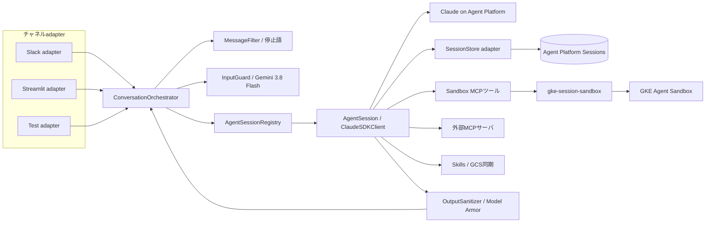
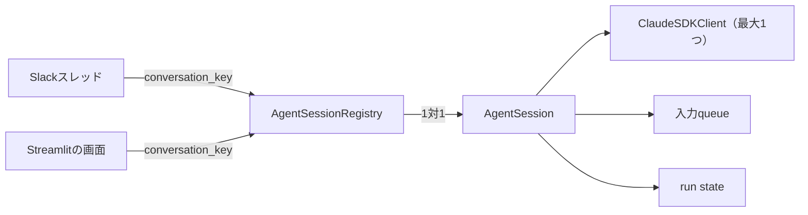

# silk-agent 仕様案

Slackから受け取った指示をClaude Agent SDKで処理し、ツールは**GKE Agent Sandbox上のセッション専用作業環境**で実行するSlackBotの仕様をまとめる。

**このREADMEは仕様書と、実装のセットアップ手順（§15）をまとめたもの。** Sandboxのライフサイクル管理とcommand / file実行は、このリポジトリの`src/gke_session_sandbox`にあるライブラリ`gke_session_sandbox`に任せる（説明は[docs/gke-session-sandbox/README.md](docs/gke-session-sandbox/README.md)）。このリポジトリでは、それより上の「Slack → Bot → Claude Agent SDK → ライブラリ」の部分を作る。公式資料の確認日は2026-10-10。

## 1. 要点

| 項目 | 方針 |
| --- | --- |
| 最終製品 | Slack Bot（Bolt for Python async + Socket Mode）。**1インスタンスだけで動かす** |
| 他のUI | 同じコアをStreamlitのチャットUIとユニットテスト用adapterからも動かす |
| エージェント | `claude-agent-sdk`の`ClaudeSDKClient`をBotプロセス内で動かす（ストリーミング入力モード） |
| モデル | **Agent Platform（旧Vertex AI）上のClaude**を使う。テストではHaiku 5.5を使う |
| ツール実行 | 組み込みのBash / Read / Write等は無効にし、`gke-session-sandbox`を呼ぶ自作SDK MCPツールに置き換える |
| 会話の永続化 | Claude Agent SDKの`SessionStore`プロトコルを実装し、[Agent Platform Sessions](https://docs.cloud.google.com/gemini-enterprise-agent-platform/scale/sessions)へ保存する |
| セッション管理 | Slackスレッドとは別の`AgentSession`として管理し、1つの会話でClaude Agent SDKのインスタンスが2つ起動しないようにする |
| 入力チェック | ルールベースのフィルタの後、Agent Platform上の`gemini-3.8-flash`で指示違反を判定する |
| 出力チェック | Model Armor（`projects/nnyn-dev/locations/us-central1/templates/simple`）でsanitizeする。個人情報はマスクして表示する |
| 停止 | スレッドに「停止」「中止」「中断」「STOP」だけを書くと、実行中の処理を止める |
| 実行中の追加指示 | 実行中にスレッドへ届いた追加指示は、同じ`AgentSession`の実行中のturnへ追記する（止めない）。設定で「interrupt → 新しい指示で再開」も選べる |
| 進捗表示 | スレッドに進捗メッセージを1つ置き、実行したツールの一覧と「最終更新 2026-10-10 18:59」を1分ごとに更新する。Botが落ちると更新が止まるので、ユーザが気付ける |
| MCP | 設定ファイル（`mcp.json`）から読み込み、`strict_mcp_config=True`で想定外の設定は読まない |
| Skills | GCSから同期したディレクトリを読み込む。Sandbox側にも同じ内容を配置する |
| Bot終了時 | 会話はSessionStoreから、作業ファイルはSandboxのPVCから復元する。実行中だったturnは「中断」として記録し、ユーザの操作で再開する（§9） |

## 2. 全体構成



処理の流れ（1ターン）は次の通り。

1. チャネルadapterが外部の入力を`InboundEvent`に変換する。
2. `MessageFilter`が対象外のメッセージを捨てる（bot投稿、許可外のchannel / user、編集イベントなど）。停止語なら`StopRequest`に変換し、ここで処理を終える。
3. `InputGuard`がGeminiで指示違反を判定する。違反ならエージェントに渡さず、理由を返信する。
4. `AgentSessionRegistry`が会話キーに対応する`AgentSession`を返す。なければ作り、`SessionStore`から過去の会話を復元する。
5. `AgentSession`が実行中なら実行中のturnへ追記し、実行中でなければ新しいturnとして`query()`する。
6. SDKのメッセージとhookを`OutboundEvent`（テキスト、ツール開始 / 終了、状態、完了、エラー）に変換する。
7. テキストとツール表示を`OutputSanitizer`（Model Armor）に通してからチャネルadapterへ送る。

## 3. アダプター設計

コアはSlackにもGCPにも依存させない。外部とつながる部分はすべてportにし、実装を差し替えられるようにする。

| Port | 本番実装 | 開発 / テスト実装 |
| --- | --- | --- |
| `ChatChannel` | `SlackChannel` | `StreamlitChannel`, `ScriptedChannel`（テスト） |
| `AgentEngine` | `ClaudeAgentEngine`（ClaudeSDKClient + Agent Platform上のClaude） | `FakeAgentEngine`（シナリオで応答とtool呼出しを返す） |
| `SandboxRuntime` | `GkeSessionSandboxRuntime` | `LocalProcessRuntime`（一時ディレクトリ）, `InMemoryRuntime` |
| `SessionStore`（SDKのプロトコル） | `AgentPlatformSessionStore` | SDK同梱の`InMemorySessionStore` |
| `SessionStateStore`（§8.3） | Agent Platform Sessionのstate | in-memory |
| `InputGuard` | `GeminiPolicyGuard` | `RuleGuard`, `AllowAllGuard` |
| `OutputSanitizer` | `ModelArmorSanitizer` | `NoopSanitizer`, 固定語をマスクする`FakeSanitizer` |
| `SkillSource` | `GcsSkillSource` | `LocalDirSkillSource` |
| `Clock` | システム時刻 | 進める時刻を指定できるfake（1分ごとの更新をテストする） |

### 3.1 チャネルとコアの間のイベント

```python
# 入力（チャネル → コア）
UserMessage(conversation_key, user, text, attachments, message_id)
StopRequest(conversation_key, user)  # 停止語
ResetRequest(conversation_key, user)  # 新しい会話として始める
ResumeRequest(conversation_key, user)  # Bot再起動で中断したturnを再開

# 出力（コア → チャネル）。テキストはsanitize済み
TurnStarted(turn_id, started_at)
AssistantText(turn_id, text)  # テキストブロック単位
ToolStarted(turn_id, tool_use_id, name, summary, started_at)
ToolFinished(turn_id, tool_use_id, status, summary, finished_at)
Heartbeat(turn_id, at)  # 1分ごと
StatusChanged(turn_id, status)  # thinking / running_tool / interrupting / interrupted
GuardBlocked(stage, reason)  # input / output
TurnFinished(turn_id, result, usage)
TurnFailed(turn_id, error)
```

`conversation_key`はチャネル側で衝突しない文字列を作る。Slackでは`slack:{team_id}:{channel_id}:{thread_ts}`、Streamlitでは`streamlit:{browser_session_id}`とする。

### 3.2 テスト

- **ユニットテスト**: `ScriptedChannel`、`FakeAgentEngine`、`InMemoryRuntime`、`InMemorySessionStore`、fakeの`Clock`を組み合わせ、GCPやSlackに接続せずに次のシナリオを動かす。
  - フィルタ、ガード、停止語、割り込み、1会話1インスタンスの保証、1分ごとの更新、再起動からの復元
- **integrationテスト（実モデル）**: Agent Platform上の**Haiku 5.5**で`ClaudeAgentEngine`を動かし、ツール呼出し、interrupt、SessionStoreからのresumeを確認する。
- **SessionStoreの適合性テスト**: `AgentPlatformSessionStore`をSDK付属の`claude_agent_sdk.testing.run_session_store_conformance`で検証する（Agent Platformへ実際に接続する）。
- **Streamlit**: 手元で`ClaudeAgentEngine`と`LocalProcessRuntime`、または`GkeSessionSandboxRuntime`を組み合わせて動作を確認する。

## 4. Slack Bot

- Bolt for Python（`AsyncApp`）+ Socket Modeで動かす。Slackへのackは3秒以内に返し、処理は別taskで行う。
- **反応する条件**: チャンネルでのメンション（`app_mention`）、Botが参加中のスレッドへの返信（`message`かつ`thread_ts`あり）、DM。
- **重複排除**: Slackの再送に備え、`event_id`（または`channel + ts`）を記録して二重処理を防ぐ。
- **状態表示**: アシスタントスレッドでは、補助的に`set_status`で「考え中」「ツール実行中」も表示する。

### 4.1 スレッド内のメッセージ構成

1つのturnで、スレッドには次のメッセージが並ぶ。

1. **進捗メッセージ**（turnごとに1つ、`chat.postMessage`で投稿し、`chat.update`で更新し続ける）
2. **エージェントの応答**（テキストブロックごとに、Model Armorを通してから`chat.postMessage`で投稿する）

進捗メッセージの例:

```text
⏳ 実行中（経過 4分）   最終更新 2026-10-10 18:59
✅ bash        git clone https://github.com/... （3秒）
✅ read_file   src/app.py
⏳ bash        uv run pytest tests/unit
停止するには「停止」と書き込んでください
```

完了時の例:

```text
✅ 完了（所要 6分 / ツール 7回 / $0.42）   最終更新 2026-10-10 19:03
...
```

- **ツール表示**: ツールの開始・終了のたびに、進捗メッセージの一覧へ反映する（`chat.update`は1秒に1回までにまとめる）。表示するのは、絵文字による状態（⏳ 実行中 / ✅ 成功 / ❌ 失敗 / ⏹ 中断）、ツール名、引数の要約、所要時間。
  - 一覧が長くなった場合は、最新の20件を表示し、残りは「ほか12件」とまとめる。
  - MCPツールは`mcp__<server>__<tool>`を`<server>/<tool>`として表示する。
- **最終更新の表示**: turnの実行中は、**1分ごとに「最終更新 YYYY-MM-DD HH:MM」**（`Asia/Tokyo`、設定で変更可）を書き換える。ツールの開始・終了などで更新したときも時刻を更新する。
  - Botが落ちると時刻が進まなくなるので、ユーザは「最終更新から何分も経っている＝止まっている」と判断できる。
  - 文言は「最終更新から5分以上経っても変わらない場合、Botが停止している可能性があります」とヘルプに書いておく。
  - 再起動後は、中断したturnの進捗メッセージを「⚠️ Botの停止により中断」に書き換える（§9）。
- 進捗メッセージの`ts`はturnの状態と一緒に保存し、再起動後も書き換えられるようにする（§8.3）。
- 1つのメッセージは12,000文字以内にし、長い出力やファイルの中身はファイルとしてアップロードする。
- **ストリーミング**: 初期版では、文字単位のストリーミング（`chat.startStream`）は使わず、テキストブロック単位で投稿する。Model Armorの検査を確実に通すため。

### 4.2 ユーザメッセージのフィルタ（ルールベース）

`MessageFilter`はチェーンで構成し、設定で有効化する。Geminiの判定より前に動かし、コストのかからない段階で除外する。

| フィルタ | 内容 |
| --- | --- |
| 送信者 | bot投稿・自分の投稿・`subtype`付きイベント（編集、参加通知など）を除外 |
| 許可リスト | workspace / channel / user / user groupのallow・deny |
| 形式 | 空メッセージ、長さ上限、添付ファイル数・サイズ上限 |
| レート | ユーザごと・会話ごとの受付頻度の上限 |
| 停止語 | 下記。エージェントには渡さない |
| コマンド | `!reset` / `!status`はエージェントへ渡さずコマンドとして処理 |

### 4.3 停止

- メッセージ全体が**「停止」「中止」「中断」「STOP」のいずれか**と一致したら`StopRequest`にする。
  - 比較の前に、前後の空白を除き、NFKC正規化（全角の「ＳＴＯＰ」も一致させる）と英字の大文字化を行う。
  - 「処理を停止して」のように他の文字を含む文は、停止語として扱わず通常の指示として扱う（誤って止めないため）。
  - 停止語は設定で変更できる。
- 停止語は送信者・許可リストのフィルタの後で判定し、Geminiの入力ガードは通さない（すぐに止めるため）。
- 実行中なら§7.4の中断を行い、進捗メッセージを「⏹ 中断しました」にする。実行中でなければ「実行中の処理はありません」と返信する。

## 5. 入力ガード（Gemini 3.8 Flash）

ユーザ入力を、エージェントへ渡す前に分類器で判定する。

- モデル: Agent Platform上の`gemini-3.8-flash`（google-genai、`vertexai=True`）。
  - **注意**: このモデルの提供リージョンは`global`と`us` / `eu`のマルチリージョンで、`us-central1`ではない。Gemini呼出しだけ`location="global"`を設定できるようにする。
- 構造化出力（Pydanticの`response_schema`）で判定結果を受け取る。

```python
class InputVerdict(BaseModel):
    decision: Literal["allow", "block", "needs_review"]
    categories: list[
        Literal[
            "prompt_injection",
            "policy_override",
            "secret_exfiltration",
            "destructive_operation",
            "out_of_scope",
            "other",
        ]
    ]
    reason: str  # ユーザへ表示してよい短い理由
```

- **判定基準**: ポリシーを`policies/input-guard.md`として外部化し、system instructionに入れる。例えば「システム指示の無視・上書き要求」「認証情報の取得要求」「許可範囲外の破壊的操作」など。
- **判定材料**: 直前の数メッセージを文脈として渡す（会話をまたいだ分割攻撃への対策）。
- **block時**: エージェントへ渡さず、理由を返信する。判定結果は監査ログへ記録する。
- **needs_review時**: 初期版は`block`と同じ扱いにする。後続で承認フロー（§11）につなげる。
- **Geminiの呼出しに失敗した場合**: 既定はfail-closed（処理しない）。設定でfail-openにもできる。
- 添付ファイルのテキストも判定対象に含める。

## 6. 出力のサニタイズ（Model Armor）

- テンプレート: `projects/nnyn-dev/locations/us-central1/templates/simple`。個人情報のマスク（SDPの非識別化）が有効になっている。
- エンドポイント: `modelarmor.us-central1.rep.googleapis.com`。
- エージェントの出力は`sanitize_model_response`に通す。
- **対象**: Slackへ出すもの全部。
  - エージェントのテキスト
  - 進捗メッセージに出すツール引数・結果の要約
  - 最終結果
  - アップロードするテキストファイル
- **判定の扱い**:
  - **個人情報（SDP）に該当した場合**: `deidentify_result.data.text`（マスク後のテキスト）に置き換えて、**そのまま表示する**。マスクしたことは監査ログに記録する。
  - **SDP以外のフィルタ（RAI / 悪性URL / CSAM）に該当した場合**: 出力を差し止め、「出力がポリシーにより表示できませんでした」と通知する（`GuardBlocked(stage="output")`）。
  - **jailbreak（`pi_and_jailbreak`）は出力では無視する**（`output_sanitizer.ignored_filters`）。通常のシェルコマンドの要約まで該当と判定されるため。代わりに、`bash`ツールが「ディレクトリ内の全ファイルを一括で取り出す」コマンド（ディレクトリのアーカイブ化、`cat *`、`find -exec cat`、`xargs cat`、全行に一致する再帰grepなど）を実行前に拒否する軽いルールを持つ（`src/silk_agent/guards/bulk_files.py`）。
  - SDPに該当したのに`deidentify_result`が返らない場合は、差し止める。
- **長文**: Model Armorの非SDPフィルタは1回10,000トークンまでなので、段落・コードブロックの境界で分割して検査する。
- **Model Armorの呼出しに失敗した場合**: fail-closed。表示を保留し、失敗したことだけを通知する。
- 差し止めた出力の本文は監査ログに残すが、Slackへは出さない。
- エージェント自身が受け取る内容（会話履歴）はマスクしない。マスクするのはSlackへの表示だけ。

## 7. エージェント（Claude Agent SDK）

### 7.1 実行形態

`gke-session-sandbox`のREADMEにある2方式のうち、**(a) Bot側でSDKを動かし、ツールだけをSandboxで実行する**方式を採る。

- interrupt、hook、SessionStore、Model Armorを1つのプロセスで扱えるため、Slackとの連携がシンプルになる。
- Sandboxには会話履歴も認証情報も置かない。Sandboxを削除しても会話は残る。
- Bot自身のローカル作業ディレクトリ（SDKの`cwd`）は会話ごとの一時ディレクトリで、捨ててもかまわない。

### 7.2 モデル（Agent Platform上のClaude）

- Claude Agent SDKを、Agent Platform（Vertex AI）経由で動かす。SDKが起動するClaude Codeに次の環境変数を渡す。
  - `CLAUDE_CODE_USE_VERTEX=1`
  - `ANTHROPIC_VERTEX_PROJECT_ID=nnyn-dev`
  - `CLOUD_ML_REGION=<Claudeを提供しているリージョン>`
- 認証はBotのサービスアカウント（Workload Identity）で行い、Anthropic APIキーは使わない。
- モデルは設定で指定する。
  - 本番: 設定値（例: `claude-opus-5-5`）
  - テスト: `claude-haiku-5-5`
- **要確認**:
  - Agent Platform上でのモデルIDの表記（`@`付きのバージョン指定が要るか）
  - 各モデルを提供しているリージョン
  - nnyn-devでモデルを有効化済みか

### 7.3 ツール

組み込みのファイル操作・シェル系ツールは`disallowed_tools`で無効にし、Sandboxを操作するSDK MCPツールを`create_sdk_mcp_server`で提供する。

| ツール（`mcp__sandbox__*`） | ライブラリAPI |
| --- | --- |
| `bash(command, cwd, timeout_seconds, run_in_background)` | `commands.start` + `commands.wait`。20秒で終わらなければバックグラウンドへ（下記） |
| `read_file(path, offset, limit)` | `files.read` |
| `write_file(path, content)` | `files.write` |
| `edit_file(path, old, new)` | `files.read` + `files.write`（置換が一意であることを確認） |
| `list_files(path)` / `glob(pattern)` / `grep(pattern, path)` | `files.list`、または`commands.run(["rg", ...])` |
| `command_status(command_id)` / `command_output(command_id, cursor)` | `commands.get` / `commands.read_output` |
| `cancel_command(command_id)` | バックグラウンドのcommandを止める（`commands.cancel`） |

- **会話とSandboxの対応**: 会話キーから`SessionKey(tenant_id=team_id, session_id=hash(channel/thread))`を作り、`manager.ensure(key, env={"USER_EMAIL": ...})`でSandboxを取得する。
- **ライブラリからの通知**: `pending_context_events`（workspace消失の通知など）は、次のturnの先頭にシステム的な文脈として追加し、保存してからackする。
- **turnの中断との関係**: 中断ではSDKのturnだけを止め、Sandbox内のcommandは`commands`のcancel APIで明示的に止める。結果が分からないcommand（`ExecutionOutcomeUnknown`）はcommand IDをツール結果として返し、エージェントが後で`command_status`で確認できるようにする。
- **バックグラウンド実行**（`src/silk_agent/core/background.py`）: 時間のかかる作業をしながら、次々に指示できるようにする。
  - `bash`は最大20秒だけ完了を待つ。終わらなければ「バックグラウンドで実行中（command_id）」を返し、エージェントはturnを終えられる。`run_in_background: true`なら待たずに返す。commandの上限時間は既定3600秒。
  - 終了すると、その会話へ`<system-notice>`（終了コード、stdout / stderrの末尾）を送る。turnの実行中ならそのturnへ追記し、待機中なら新しいturnを始めて、エージェントが結果をユーザに報告する。
  - 停止語では、実行中のturnに加えてバックグラウンドのcommandも止める（終了通知は送らない）。turnの中断でツール呼出しが取り消されても、バックグラウンドのcommandは止めない。
  - 進捗メッセージでは、バックグラウンドに移ったツールを「🔄 バックグラウンドで実行中」と表示する。
  - 制限: Botが再起動すると、実行中だったcommandの終了通知は届かない（commandはSandboxで動き続け、IDは管理情報に残る）。
- **追記の取りこぼし防止**: CLIを`--replay-user-messages`で起動し、送ったプロンプトがCLIに消費されたことを数える。`ResultMessage`の時点で未消費のプロンプトがあれば（turnの終わり際に追記した場合）、CLIが続けて始める応答も同じturnとして読み続ける。

### 7.4 主要なオプション

```python
ClaudeAgentOptions(
    model=config.agent.model,              # 本番: 設定値 / テスト: claude-haiku-5-5
    env={"CLAUDE_CODE_USE_VERTEX": "1", ...},
    system_prompt=...,                     # policies/agent-system.md
    cwd=per_conversation_tmpdir,
    disallowed_tools=["Bash", "Read", "Write", "Edit", "Glob", "Grep", "NotebookEdit"],
    mcp_servers={"sandbox": sandbox_server, **external_mcp},
    strict_mcp_config=True,
    setting_sources=["project"],           # 同期したskillsを読ませる。user設定は読まない
    skills="all",
    hooks={"PreToolUse": [...], "PostToolUse": [...], "PostToolUseFailure": [...], "Stop": [...]},
    can_use_tool=approval_callback,        # 承認が必要なツールのみ（§11）
    session_store=AgentPlatformSessionStore(...),
    session_store_flush="eager",
    resume=claude_session_id_or_None,
    max_turns=...,
)
```

### 7.5 セッション管理（1会話につき1インスタンス）

Slackのスレッドとは別に、エージェント側のセッションを`AgentSession`として管理する。



- `AgentSessionRegistry`は`conversation_key → AgentSession`の辞書を持つ。取得・作成は`asyncio.Lock`で直列化し、**同じ会話に`AgentSession`が2つできないようにする**。
- `AgentSession`は`ClaudeSDKClient`を最大1つだけ持ち、状態（`idle` / `running` / `interrupting`）と入力queueを管理する。チャネルからの入力はすべてこのqueueに入れ、1つのworker taskが順に処理する。
  - そのため、処理中にスレッドへ書き込まれても、新しいSDKインスタンスは起動しない。同じ`AgentSession`の実行中のturnへの追記として扱う。
- **Botは1インスタンスで動かす前提**のため、プロセスをまたいだ排他（lease）は実装しない。
- 一定時間（例: 10分）入力がない`AgentSession`は、`ClaudeSDKClient`を`disconnect()`して解放する。次の入力のときにSessionStoreから`resume`する。

### 7.6 中断と割り込み

- **中断（StopRequest）**: `client.interrupt()`を呼び、`receive_response()`で残りのメッセージを読み切る。
  - 実行中のSandbox commandをcancelする。
  - 進捗メッセージを「⏹ 中断しました」にして`idle`に戻る。
- **実行中のUserMessage**: 既定は**追記（`interrupt_mode: append`）**。実行中のturnを止めずに、streaming inputで同じturnへメッセージを送る（`client.query()`）。モデルは実行中のツールの完了後にそれを読み、同じturnの中で答える（claude-agent-sdk 0.2.165で確認）。
  - スレッドには「実行中の処理に追加しました。今の処理を止めずに、続けて対応します（止める場合は「停止」…）」と返す。
  - turnがすでに結果（`ResultMessage`）を受け取った後など、追記できない場合は次のturnとしてqueueに積む。
  - 設定で`interrupt`（interrupt → 読み切り → 新しいメッセージで新しいturn）と`queue`（現在のturnの完了後に処理する）も選べる。`interrupt`では割り込まれたturnの進捗メッセージを「↪ 新しい指示で再開」にして閉じる。
  - 追記・割り込みのメッセージも入力ガードを通す。
- 中断でツール呼出しが取り消された場合、待っていたSandbox commandもcancelする（走り続けないようにする）。

### 7.7 ツール実行の表示

- `PreToolUse`: `ToolStarted`を出す。表示する要約はツールごとに整形する（例: bashはコマンドの先頭行、read_fileはパス）。
- `PostToolUse` / `PostToolUseFailure`: `ToolFinished`を出す（成功 / 失敗、所要時間、終了コード）。
- Slackでは進捗メッセージの一覧に反映する（§4.1）。Streamlitでは`st.status`で表示する。
- 要約は表示前にModel Armorに通す。
- 表示の詳細度は設定で`name`（ツール名だけ）/ `summary`（既定）/ `verbose`（出力の先頭数行も出す）から選べる。

### 7.8 MCP

- `config/mcp.json`をSDKの`mcp_servers`へ渡す。`strict_mcp_config=True`で、`.mcp.json`やユーザ設定、プラグイン由来の設定は読まない。
- 認証情報は`${ENV}`参照で、Secret Managerから注入する。
- **トランスポート**: 初期版はHTTP / SSEのMCPだけを許可する。stdioのMCPはBotのPod内でプロセスとして動いてしまうため、許可リストに入れたものに限る。
- `get_mcp_status()`で起動時の接続状態をログに出す。`!status`コマンドでも表示する。
- MCPツールの結果は外部からの入力として扱う（§11の間接プロンプトインジェクション対策）。

### 7.9 Skills（GCS）

- `gs://<bucket>/skills/<name>/SKILL.md ...`を、起動時と定期的に（例: 5分ごと）ローカルの`skills-cache/<generation>/.claude/skills/`へ同期する。
  - 同期は、オブジェクトのgenerationとmanifest（ハッシュ）で更新を判定する。
- 会話の`cwd`へ`.claude/skills`をsymlinkで配置し、`setting_sources=["project"]`で読ませる。
  - 同期は世代を切り替える方式にし、実行中のturnは同期開始時点の世代を見続けるようにする。
- **Sandbox側への配置**: Skillに付属するスクリプトはツール（Sandbox）で実行されるため、`ensure`の後、同じ世代のSkillsを`/workspace/.skills/`へコピーする。SKILL.mdの中のパスはSandboxのパスで書く運用にする。
  - 将来は、共有コードPVC（readOnly）に配置する方式へ移す。
- 読み込み対象のskillは許可リストで指定できる。GCSバケットへの書込み権限は運用者に限定する。

## 8. セッションストア（Agent Platform Sessions）

[Agent Platform Sessions](https://docs.cloud.google.com/gemini-enterprise-agent-platform/scale/sessions)は、ユーザとエージェントのやり取りを、セッション（会話）、イベント（メッセージやツール呼出し）、state（会話中の一時データ）として保存するサービス。ADKを使わない場合はAPIで操作できる。利用にはAgent Runtimeのインスタンスが必要だが、コードのデプロイは要らない。

ここに次の2つを保存する。

| 保存するもの | 保存先 |
| --- | --- |
| Claude Agent SDKの会話記録（transcript） | Sessionのevents（§8.1） |
| run state、進捗メッセージの位置などの管理情報 | Sessionのstate（§8.3） |

### 8.1 SessionStore adapter

Claude Agent SDKの`SessionStore`プロトコル（必須は`append` / `load`）を`AgentPlatformSessionStore`として実装する。

| SDKの概念 | Agent Platformへの対応付け |
| --- | --- |
| `SessionKey.session_id`（UUID） | Agent Platform Sessionの`session_id`。SDKのUUIDを英小文字・数字・ハイフンに正規化し、英字で始まる63文字以内にする |
| `SessionKey.project_key` | 1つのBotでは固定値になるので、session stateに保存し、検証にだけ使う |
| `SessionKey.subpath`（サブエージェント） | 同じSessionのeventに`subpath`を付けて区別する |
| `append(key, entries)` | `client.sessions.events.append(..., config={"raw_event": ...})`。entry 1件を1 eventにする |
| `load(key)` | `client.sessions.events.list`で全件を取得し、`subpath`で絞り込んでentryの順に並べる |
| `user_id` | `slack:{team_id}:{user_id}`（128文字以内） |
| TTL | Sandboxの保持期限（7日）以上を設定する。初期案は30日 |

- **重複排除**: `append`は再送されうるので、`entry.uuid`で重複を除く（eventの中にuuidを保存し、`load`で除去する）。
- **書込み失敗**: SDKは`append`を3回まで試し、失敗するとそのバッチを捨てて`mirror_error`を出す。`mirror_error`を受け取ったらturn完了の通知に警告を付け、メトリクスへ記録する。
- **要検証**:
  - 1 eventのサイズ上限と、長いtool結果の扱い（上限を超える場合はGCSに置いて参照だけ保存する）
  - `events.list`のページングと性能
  - Python clientは`agentplatform`と`vertexai`のどちらを使うべきか

### 8.2 会話とセッションの対応

| キー | 値 |
| --- | --- |
| `conversation_key` | `slack:T…:C…:1712345678.000100` |
| Claudeの`session_id` | 会話の最初のturnで発行される。`!reset`で新しいIDにする |
| Sandboxの`SessionKey` | `conversation_key`から作る。`!reset`しても既定では同じ作業環境を使う（設定で変更可） |

### 8.3 SessionStateStore（管理情報）

`conversation_key`ごとに管理用のAgent Platform Sessionを1つ作り、そのstateに次の情報を保存する。Botの再起動後に、中断したturnを見つけて表示を書き換えるために使う。

| 項目 | 内容 |
| --- | --- |
| `claude_session_id` | 現在のClaudeのセッションID |
| `run_state` | `idle` / `running` / `interrupted(reason)` |
| `turn_id`, `turn_started_at` | 実行中のturn |
| `progress_message` | 進捗メッセージの`channel`と`ts` |
| `running_command_ids` | 実行中のSandbox command |
| `bot_instance_id` | turnを実行しているBotの起動ID（起動ごとに新しく発行する） |
| `last_heartbeat_at` | 最後に進捗メッセージを更新した時刻 |
| `processed_event_ids` | 重複排除用の直近のSlack `event_id` |

- 管理用セッションの検索は`user_id`を`bot:{conversation_key_hash}`にし、`running`のものを起動時に列挙できるようにする。
- **要検証**: stateの更新APIと、`running`のセッションを効率よく列挙する方法。足りなければFirestoreへ切り替える（`SessionStateStore` portの実装を差し替える）。

## 9. Bot終了・再起動時の扱い

結論: **会話はSessionStoreから、作業ファイルはSandboxから復元できる。失われるのは「Bot内で実行中だったturn」だけ**。それをユーザが分かるように表示し、ユーザの操作で再開する。

| 対象 | 保存先 | Bot終了後 |
| --- | --- | --- |
| 会話履歴（SDKのtranscript） | Agent Platform Sessions | 残る。`resume`で続けられる |
| 作業ファイル | SandboxのPVC | 残る。5分idleで自動停止し、7日で削除される（ライブラリの仕様） |
| Sandboxで実行中のcommand | CommandTracker | Botが落ちても実行を続ける。command IDで結果を取得できる |
| 実行中のturn（LLM待ち、hook） | Botのメモリ | 失われる |
| 進捗メッセージ | Slack | 「最終更新」の時刻が止まる |

### 9.1 Botが落ちたことをユーザが知る方法

- **実行中**: 進捗メッセージの「最終更新」が1分ごとに進む。進まなくなれば、Botが止まっていることが分かる（§4.1）。
- **再起動後**: 下記の手順で、進捗メッセージを「⚠️ Botの停止により中断」に書き換え、スレッドに通知する。
- **Botが起動しないまま**の場合は、時刻が止まった状態のままになる。これに備え、外部の監視（Cloud MonitoringのアラートやUptime check）で運用者に通知する（§11）。

### 9.2 正常終了（SIGTERM）

1. 新しい入力の受付を止める（Socket Modeの接続を閉じる）。
2. 実行中のturnには猶予（例: 25秒、Podの`terminationGracePeriodSeconds`の範囲内）を与えて完了を待つ。
3. 猶予内に終わらなければ`interrupt()`し、run stateを`interrupted(reason="shutdown")`にする。進捗メッセージを「⚠️ Botの再起動で中断しました」にし、スレッドへ「続けて」と書けば再開できることを投稿する。
4. SessionStoreへのflushが終わってから終了する。

### 9.3 異常終了（クラッシュ、ノード障害）

- 起動時に、`run_state=running`で`bot_instance_id`が今回の起動IDと違う会話を探す。1インスタンス前提なので、これらはすべて前回の起動で中断されたものとみなす。
- 該当する会話を`interrupted(reason="crash")`に変え、進捗メッセージを「⚠️ Botの停止により中断（最終更新 2026-10-10 18:59）」に書き換え、スレッドへ通知する。

### 9.4 再開

- 次のユーザメッセージ（「続けて」など）、または`!resume`で、`resume=<claude_session_id>`として再開する。
- 先頭に「前回のturnはBotの停止で中断された。中断時に実行中だったcommand: <id>」という文脈を追加する。結果が分からないcommandの扱いはエージェントに任せる（`command_status`ツールで確認できる）。
- **自動では再開しない**のを既定にする。副作用のある処理を二重に実行するのを防ぐため。設定で自動再開もできるようにする。
- **要検証**: transcriptが`tool_use`の途中（対応する`tool_result`がない状態）で切れている場合に、SDKがresumeできるか。できない場合は、adapterが`load`時に「中断された」というtool_resultを補う。

## 10. 設定ファイル案

```yaml
slack:
  app_token_secret: projects/nnyn-dev/secrets/slack-app-token
  bot_token_secret: projects/nnyn-dev/secrets/slack-bot-token
  stop_words: ["停止", "中止", "中断", "STOP"]
  interrupt_mode: append           # append | interrupt | queue
  progress:
    heartbeat_interval_seconds: 60
    timezone: Asia/Tokyo
    max_tools_shown: 20
    tool_display: summary          # name | summary | verbose
filter:
  allowed_teams: [T000]
  allowed_channels: []             # 空 = 全チャンネル
  max_message_chars: 8000
input_guard:
  provider: gemini
  model: gemini-3.8-flash
  location: global
  policy_file: policies/input-guard.md
  on_error: block
output_sanitizer:
  provider: model_armor
  template: projects/nnyn-dev/locations/us-central1/templates/simple
  endpoint: modelarmor.us-central1.rep.googleapis.com
  on_sdp_match: mask               # mask | block
  on_other_match: block
  on_error: block
session_store:
  provider: agent_platform
  project: nnyn-dev
  location: us-central1
  agent_runtime: projects/nnyn-dev/locations/us-central1/reasoningEngines/<id>
  ttl_seconds: 2592000
agent:
  provider: agent_platform         # CLAUDE_CODE_USE_VERTEX=1
  project: nnyn-dev
  region: <Claudeの提供リージョン>
  model: claude-opus-5-5           # テストでは claude-haiku-5-5
  max_turns: 50
  max_budget_usd_per_turn: 2.0
  idle_client_timeout_seconds: 600
mcp:
  config_file: config/mcp.json
skills:
  source: gs://<bucket>/skills
  sync_interval_seconds: 300
sandbox:
  config_file: config/sandbox-config.yaml   # gke-session-sandboxの設定
```

## 11. 追加を提案する機能

依頼に含まれていないが、必要になりそうな機能。優先度の高い順に並べる。

| # | 機能 | 理由 |
| --- | --- | --- |
| 1 | **ツール結果の検査（間接プロンプトインジェクション対策）** | Webページ、MCP、リポジトリ内のファイルから入る指示は、入力ガードを通らない。`PostToolUse`でModel Armorの`sanitize_user_prompt`（`pi_and_jailbreak`）を実行し、該当すれば結果を差し替えるか警告を付ける |
| 2 | **入力にもModel Armorを使う** | Geminiの分類は指示違反（ポリシー）を、Model Armorはjailbreak・機密情報（SDP）を判定する。役割が違うので両方使う |
| 3 | **Botの死活監視** | Botが起動しないままだと、ユーザには「最終更新が止まっている」ことしか分からない。Socket Modeの接続状態をメトリクスに出し、止まったら運用者へアラートする |
| 4 | **危険な操作の承認（Human-in-the-loop）** | `can_use_tool`と特定のツール・パターン（例: `git push`、外部へのPOST）に対して、Slackの承認ボタンを出す。入力ガードの`needs_review`もここにつなげる |
| 5 | **予算と上限** | turnごとの`max_turns` / コスト上限、ユーザごとの日次上限、同時に実行できる会話数の上限。完了時に使用量を表示する |
| 6 | **ユーザの識別と権限** | Slackの`users.info`からメールアドレスを取得し（`users:read.email`）、Sandboxの`USER_EMAIL`として渡す。ユーザごとに使えるMCP / skillを切り替える |
| 7 | **会話コマンド** | `!reset`（新しい会話）、`!status`（Sandbox、MCP、実行中commandの状態）、`!resume`（中断したturnの再開） |
| 8 | **ファイルの受け渡し** | Slackの添付ファイルをSandboxの`/workspace/inbox/`へ置き、Sandboxで作った成果物をSlackへアップロードする（アップロード前にModel Armorを通す） |
| 9 | **監査ログ** | 入力、ガードの判定、ツール呼出し、マスク・差し止めした出力をCloud Loggingへ構造化して記録する。秘密情報はマスクする |
| 10 | **オブザーバビリティ** | turn・ツール・ガード呼出しのOpenTelemetryトレース。レイテンシ、ブロック率、`mirror_error`件数を計測する |
| 11 | **誤判定へのフィードバック** | ブロックした通知に「誤判定を報告」ボタンを付け、ガードのポリシー改善に使う |
| 12 | **データ保持と削除** | SessionStoreのTTL、Sandboxの7日、監査ログの保持期間を揃え、ユーザ・会話単位で削除できるAPIを用意する |

## 12. ディレクトリ構成案

```text
src/silk_agent/
  core/            # orchestrator, session registry, agent session, events, ports
  channels/        # slack/, streamlit/, scripted/
  agent/           # claude engine, hooks, sandbox mcp tools, fake engine
  guards/          # message filter, stop words, gemini input guard, model armor sanitizer
  stores/          # agent platform session store, session state store
  skills/          # gcs sync
  sandbox/         # gke-session-sandbox / local / in-memory runtime
  config.py
apps/
  slack_bot.py
  streamlit_app.py
policies/          # input-guard.md, agent-system.md
config/            # mcp.json, sandbox-config.yaml, silk-agent.yaml
tests/unit/ tests/integration/
```

## 13. 実装の順序

1. **コアとテスト用adapter**: イベント型、ports、`ConversationOrchestrator`、`AgentSessionRegistry`、`AgentSession`の状態遷移。`ScriptedChannel`、`FakeAgentEngine`、fakeの`Clock`を使い、停止語・割り込み・1会話1インスタンス・1分ごとの更新をユニットテストする。
2. **Claude Agent SDKとローカル実行**: `ClaudeAgentEngine`（Agent Platform上のClaude）、hook、Sandbox MCPツールを`LocalProcessRuntime`の上で動かす。Streamlit UIもここで作る。
   - Haiku 5.5で、割り込みのSDK挙動（queueされるか注入されるか）と、`tool_use`途中のresumeを検証する。
3. **SessionStore**: `AgentPlatformSessionStore`と、その適合性テスト。`SessionStateStore`と、再起動からの復元。
4. **ガード**: MessageFilter、Gemini入力ガード、Model Armor出力sanitize（個人情報のマスク表示を含む）。
5. **Slack adapter**: Bolt + Socket Mode、進捗メッセージ（ツール一覧と1分ごとの最終更新）、停止語、コマンド、重複排除、正常終了の処理。
6. **SandboxとMCP / Skills**: `GkeSessionSandboxRuntime`への切り替え（ライブラリのcommand / file APIが実装されてから）、MCP設定、GCSからのSkills同期。
7. **§11の提案機能**: 合意したものから順に追加する。

## 14. 未確定事項

検証して確定した項目（2026-10-10）:

- 実行中に追加したメッセージの扱い → **現在のturnに注入される**（`ResultMessage`は1つ）。「割り込み」には使えないため、既定は「interrupt → 読み切り → query」（`openspec/changes/add-silk-agent/design.md` D3）。
- Agent Platform上のClaudeのモデルID・リージョン → `claude-haiku-5-5`をリージョン`global`で利用できた（`CLOUD_ML_REGION=global`）。
- Agent Platform Sessionsの1 eventのサイズ → 4 MiBまで保存できた。ただしサイズに比例して遅くなる（design.md D7）。Python clientは`vertexai`（`agentplatform.Client`には`agent_engines`がまだない）。
- `tool_use`の途中で切れたtranscriptのresume → エラーにならず再開できた。
- 組み込みツールの無効化 → `disallowed_tools`で列挙して無効にしている。

未確定・既知の問題:

- 本番で使うClaudeモデル（設定`agent.model`）。
- `gke-session-sandbox`と`google-cloud-aiplatform`のprotobuf競合は、ライブラリ側の制約が`>=6.31.1,<7`になったため解消済み（依存に追加済み）。GKEでのE2Eは、ライブラリのcommand/file APIの実装待ち。
- 既存の Model Armor テンプレート`simple`は、個人情報（SDP）が`basicConfig`のため、メールアドレスを検出できず、マスクもできない。マスク表示には`advancedConfig`（DLPのdeidentifyテンプレート）が必要（`terraform/main.tf`に定義）。
- `gke-session-sandbox`のcommand / file APIは未実装のため、`GkeSessionSandboxRuntime`はREADMEのAPI案に合わせたモックでのみ検証している。

## 15. セットアップと実行

### 15.1 前提

- Python 3.12以上、[uv](https://docs.astral.sh/uv/)、Terraform、gcloud。
- `gcloud auth application-default login`でADCを設定する（Claude・Gemini・Model Armor・Sessionsの呼出しに使う）。
- `uv sync`で依存を入れる。

### 15.2 GCPリソース

`terraform/`に、プロジェクト`nnyn-dev`のリソースを定義している（`terraform init && terraform plan`で内容を確認してから`apply`する）。

| リソース | 用途 |
| --- | --- |
| API（aiplatform、modelarmor、storage、secretmanager、dlp） | 各サービスの有効化 |
| Agent Runtimeインスタンス（`google_vertex_ai_reasoning_engine.sessions`） | 会話履歴と管理情報（Sessions）の親。`terraform output agent_engine_name`を設定の`session_store.agent_runtime`に入れる |
| Model Armorテンプレート`simple` + DLPのinspect / deidentifyテンプレート | 出力のsanitize。個人情報はマスクして表示する。**`simple`が既にある場合は`terraform import google_model_armor_template.simple projects/nnyn-dev/locations/us-central1/templates/simple`で取り込む。個人情報のマスクには`advancedConfig`への変更が必要** |
| GCSバケット | Skills（`skills.source`に`gs://<bucket>/skills`を設定） |
| Secret Manager（空のシークレット） | Slackのトークン。`printf %s "$TOKEN" \| gcloud secrets versions add silk-agent-slack-bot-token --data-file=-` |
| サービスアカウント`silk-agent-bot` + IAM | Workload Identityで使う |

### 15.3 Slackアプリ

1. Socket Modeを有効にし、`connections:write`のApp-Level Tokenを作る（`xapp-...`）。
2. Bot Token Scopes: `app_mentions:read`、`channels:history`、`groups:history`、`im:history`、`chat:write`、`files:write`、`users:read`、`users:read.email`。
3. Event Subscriptions（Bot Events）: `app_mention`、`message.channels`、`message.groups`、`message.im`。
4. ワークスペースへインストールし、Bot Token（`xoxb-...`）を控える。

### 15.4 設定

`config/silk-agent.example.yaml`を`config/silk-agent.yaml`へコピーし、次を埋める（§10の項目の意味は同じ）。

- `slack.*_secret`: Secret Managerのリソース名。ローカルでは環境変数`SLACK_BOT_TOKEN` / `SLACK_APP_TOKEN`が優先される。
- `filter.allowed_teams`: 許可するワークスペースのID（空にすると全ワークスペース）。
- `session_store.agent_runtime`: 15.2の出力。`<id>`のままだと、会話の管理情報はメモリ上にだけ保存される（再起動で消える）。
- `agent.model` / `agent.region`: 使うClaudeのモデルと提供リージョン。
- `mcp.config_file`: `config/mcp.json`（`{"mcpServers": {...}}`。HTTP / SSEのみ。`${ENV}`を展開する）。
- `sandbox.runtime`: Slack Botでは`gke_session_sandbox`（`local_process`は拒否される）。

### 15.5 起動

```bash
# Streamlit（開発用。既定はLocalProcessRuntime: ホストでコマンドを実行し、隔離はしない）
uv run streamlit run apps/streamlit_app.py
#   SILK_AGENT_MODEL=claude-haiku-5-5   使うモデルを上書き
#   SILK_AGENT_GUARD=off                入力ガードと出力sanitizeを無効にする
#   SILK_AGENT_SKILLS=/path/to/skills   ローカルのSkillsを読む

# Slack Bot（1インスタンスだけで動かす）
SILK_AGENT_CONFIG=config/silk-agent.yaml uv run python apps/slack_bot.py
```

Slack Botは、起動時に前回のBotが中断したturnを検出してスレッドへ知らせる。SIGTERMでは、新しい入力を止め、実行中のturnに最大25秒の猶予を与えてから、残りを「中断（再起動）」として保存して終了する。

### 15.6.1 GKEへのデプロイ

Slack Botは`gke-session-sandbox`のクラスタ（`research-gke-agent-sandbox-with-sandboxd`）の`session-sandbox-system` namespaceで、1 Podだけ動かす。BotがライブラリのSQLite Repository（専用PVC）を持ち、idle停止・保持期限のreconcilerも同じプロセスで動かす。マニフェストは`k8s/`にある。

| ファイル | 内容 |
| --- | --- |
| `k8s/kustomization.yaml` | 全体。設定は`k8s/config/`からConfigMapを生成する |
| `k8s/config/silk-agent.yaml` | Botの設定（モデル、ガード、Sessions、Sandbox） |
| `k8s/config/sandbox-config.yaml` | `gke-session-sandbox`の設定（runtime image、idle / 保持期限） |
| `k8s/deployment.yaml` | replicas 1、`Recreate`、`terminationGracePeriodSeconds: 45` |
| `k8s/pvc.yaml`, `k8s/storageclass.yaml` | SQLite Repository用のPVC（Retain） |
| `k8s/serviceaccount.yaml`, `k8s/rbac.yaml` | KSA `silk-agent`と、Sandbox namespaceの`sandbox-management` Roleへの紐付け |

```bash
gcloud container clusters get-credentials research-gke-agent-sandbox-with-sandboxd --region us-central1 --project nnyn-dev
./k8s/grant-iam.sh   # Workload Identityで aiplatform.user / modelarmor.user を付与（初回のみ）
./k8s/deploy.sh      # イメージのビルド・push、.envからSecret作成、apply、rollout待ち
kubectl -n session-sandbox-system logs deploy/silk-agent -f
```

- `.env`の`SLACK_BOT_TOKEN` / `SLACK_APP_TOKEN`だけがSecret `silk-agent-slack`に入る。トークンを変えたら`./k8s/deploy.sh`を再実行する。
- Secret `silk-agent-sandbox`（`environment-fingerprint-key`）は、Sandbox作成時のenv（`USER_EMAIL`）の同一性を判定するHMAC鍵。`deploy.sh`が初回だけ生成し、起動時に`environment_fingerprint_key`としてSandbox設定へ注入する。変えると既存のSandboxと衝突するので、作り直さない。
- イメージは`Dockerfile`でビルドする（`k8s/build-image.sh`）。
- Sandbox Pod側のruntime image（sandboxd + CommandTracker）は`scripts/build-session-runtime-image.sh`でビルドし、`k8s/config/sandbox-config.yaml`の`runtime.image`にdigestを書く。

### 15.6 テスト

```bash
uv run pytest                      # ユニット（外部に接続しない）
uv run ruff check . && uv run pyright
# 実サービスに接続するテスト（課金対象。Haiku 5.5 / Gemini / Model Armor / Sessions）
SILK_AGENT_TEST_RUNTIME=projects/<project>/locations/us-central1/reasoningEngines/<id> \
  uv run pytest -m integration
#   メールのマスクの確認には、SDPがadvancedConfigのテンプレートを使う:
#   SILK_AGENT_TEST_TEMPLATE=projects/<project>/locations/us-central1/templates/<id>
```

`SILK_AGENT_TEST_RUNTIME`は、テスト用のsessionを作るAgent Runtimeインスタンス（sessionはTTL 1日で消える）。
