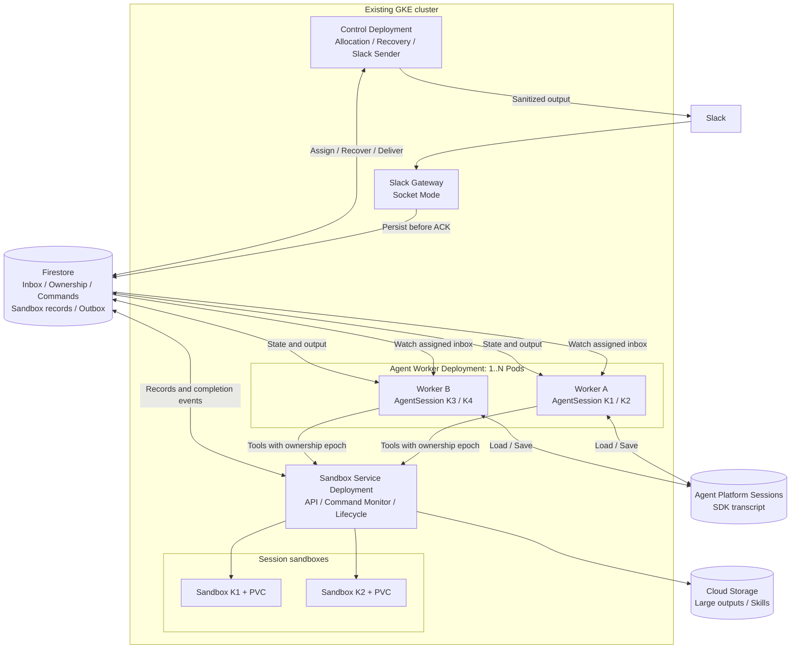
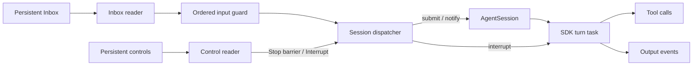
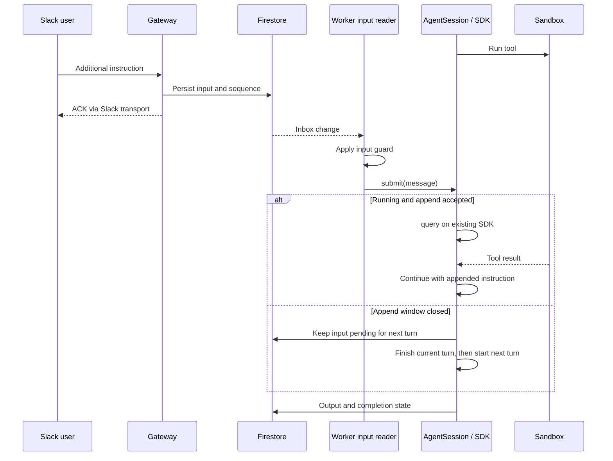
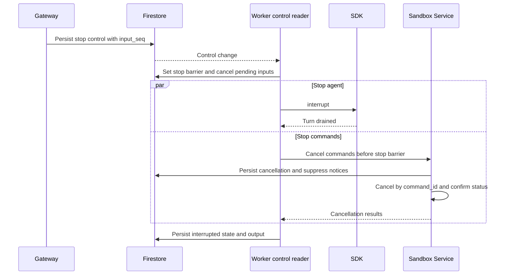
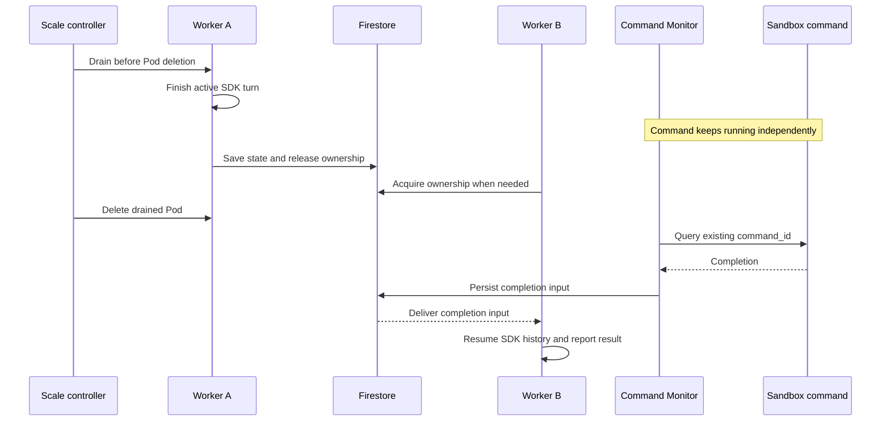

# 分散実行構成の提案

作成日: 2026-10-13。実装前の設計案。以下の数値は初期設定の候補であり、性能保証ではない。

2026-10-14 更新: Terraform で `nnyn-dev/us-central1` に専用 Firestore
Standard database `silk-agent` と index/TTL 設定を作成し、GKE Workload
Identity を使った一時 Job から入力受付・query・capacity 制限付き割当を
実データベースで確認した。詳細と cleanup 結果は
[Firestore index plan](firestore-index-plan.md) を参照。Slack の通常運用は
まだ分散構成へ切り替えていない。

## 1. 方針

**既存の GKE を実行基盤として使い、共有状態を Firestore に保存する。会話ごとに担当 Worker を一つ決め、その Worker が AgentSession と Claude Agent SDK を保持する。**

SQLite は共有状態の保存先から外す。Slack の受信、Agent 実行、Sandbox 管理、Slack 送信を分離し、各プロセスを再起動・増設できるようにする。初期構成は 1 Worker に複数会話を収容する。1 会話 1 Pod は、メモリ制限や障害分離が必要になった段階で選択できる。

実行中の追記・中断・バックグラウンド完了通知を必須要件とする。メッセージごとに SDK を起動して turn 完了までキューを占有する構成にはしない。

この文書でいう「単一 SDK」は、正常稼働中の会話に対する一つの有効な SDK を意味する。障害後は保存済み履歴から新しい SDK を起動する。生きた SDK のメモリや実行スタックの移送は行わない。

## 2. 維持する会話制御

| 現在の振る舞い | 分散構成での実現方法 |
| --- | --- |
| 同じスレッドは同じ SDK で処理 | 会話所有権を取得した Worker だけが AgentSession を作成 |
| ツール実行中にも追加指示 | Inbox reader が turn task と並行稼働し、既存 SDK の append を呼ぶ |
| turn 終了間際の追記を取りこぼさない | 現行 Engine の送信数・echo 数の追跡を維持。append 不可なら次 turn に渡す |
| interrupt モード | 現在の turn を中断し、終了を待って追加指示の turn を開始 |
| queue モード | 追加指示を永続 Inbox に残し、現 turn の後に実行 |
| 停止語による停止 | 通常入力とは別の制御経路で SDK を中断し、その会話のコマンドも停止 |
| 停止時に待機中の依頼を破棄 | 停止の受付順序を境界に、未実行入力を cancelled に変更 |
| 長いコマンドをバックグラウンド化 | 既定 20 秒、または明示指定で command_id を返す。実体は Sandbox で継続 |
| 先に返答し、完了後にもう一度返答 | コマンド監視が完了イベントを Inbox に作成し、AgentSession.notify に配送 |
| 別 turn の実行中にバックグラウンド処理が完了 | 完了通知を現在の turn に追記。通知で turn を中断しない |
| Agent が idle のときに処理が完了 | 通知を入力とする新 turn を開始。担当不在なら Worker を割り当てる |
| バックグラウンドだけ動いているときの停止 | SDK の有無に依存せず、永続コマンド台帳から停止 |
| 停止したコマンドの完了通知を抑止 | cancel_requested と notification_state を永続化し、通知配送直前にも確認 |
| 追加指示による turn 中断ではバックグラウンド処理を維持 | new_message、Worker の drain / shutdown、ユーザの stop を区別。コマンド取消は明示的な停止方針に限る |
| reset / resume | 同じ会話の制御経路で処理。reset は会話世代を更新し、旧履歴を再利用しない |
| 進捗・heartbeat・準備中の表示 | Outbox 経由で既存の Slack 表示を維持 |
| 入力ガード・出力検査 | 入力ガードは SDK 配送前、出力検査は Slack 投稿前に必ず実施 |
| 作業環境の消失通知・Skills | 初期化通知の確認応答、turn 中に Skills を切り替えない制御を維持 |

根拠となる現行コード: [session.py](../src/silk_agent/core/session.py)、[engine.py](../src/silk_agent/agent/engine.py)、[background.py](../src/silk_agent/core/background.py)、[sandbox_tools.py](../src/silk_agent/agent/sandbox_tools.py)、[orchestrator.py](../src/silk_agent/core/orchestrator.py)。

## 3. 採用するプロダクトと配置

| プロダクト | 配置・用途 | 選定理由 |
| --- | --- | --- |
| GKE Standard | 既存クラスタを継続。Gateway、Worker、Sandbox Service、Sender、Sandbox Pod を配置 | 長時間動く SDK と既存 Agent Sandbox を収容でき、既存の計算資源を共用できる |
| Firestore Standard edition / Native mode | GKE と同じ us-central1 の regional DB。Inbox、所有権、会話管理情報、コマンド台帳、Sandbox 管理情報、Outbox | 常時起動する DB インスタンスを追加せず、トランザクションと変更通知を利用できる |
| Agent Platform Sessions | 既存 SDK transcript の保存を継続 | 現行 SessionStore と resume の仕組みを活かす。所有権や最新管理状態は Firestore へ移す |
| GKE Agent Sandbox + gVisor | 会話ごとのツール実行環境 | 現行の隔離とライフサイクル管理を維持 |
| Persistent Disk / PVC | 会話ごとの /workspace | ファイルを維持。SQLite 管理用の Bot PVC は移行後に不要になる |
| Cloud Storage | 大きいコマンド出力・添付・必要な成果物。Firestore には参照だけ保存 | DB のドキュメント肥大化を避ける。既存 Skills 配布にも継続利用 |
| Secret Manager / Workload Identity Federation for GKE | Slack 秘密情報、各サービスの GCP 認証 | サービスごとに権限を分離 |
| Cloud Logging / Cloud Monitoring | 失効、滞留、SDK 数、メモリ、配送失敗、費用の観測 | 既存 GCP 運用に統合 |
| Artifact Registry | 各コンポーネントと Sandbox のイメージ | 既存構成を継続 |

最初は Pub/Sub、Cloud Tasks、Cloud SQL、Memorystore を追加しない。Firestore の Inbox を配送の正本とし、変更通知で低遅延に受信する。通知断の復旧は DB の再読み取りで行う。

### 構成図



小規模時は Control の割当・復旧・送信を同一 Deployment に同居させる。各役割は独立したループとし、長い処理で相互にブロックしない。Sandbox API と監視も当初は同じ Deployment に同居できる。状態をメモリだけに置かないため、後から分割できる。

Gateway は最初は Socket Mode を維持する。複数接続のどちらにイベントが届いても同じ Firestore に書く。ACK より前の永続化が必要なので、現行 Bolt listener が即時復帰して裏で処理する経路は変更する。Socket Mode の envelope 受信・ACK 境界で永続化を挟み、二重 ACK を避ける。

将来 HTTP Events API に移す場合は、Gateway だけ Cloud Run（request-based billing）へ移す選択肢がある。3 秒以内の ACK に対するコールドスタートの影響を測り、必要なら min instances を設定する。その場合は待機費用も計上する。[Slack Events API](https://docs.slack.dev/apis/events-api/)

## 4. Firestore のデータモデル

会話キーは現行の `slack:{team}:{channel}:{thread_ts}` を維持し、ドキュメント ID はそのハッシュを使う。DM の会話分割も現行仕様を維持する。

| コレクション / ドキュメント | 主な内容 |
| --- | --- |
| conversations/{keyHash} | 元の会話キー、参加状態、最初の承認済みユーザ、SDK session_id、turn 状態、conversation_generation、next_input_seq、stop_seq、割当待ちフラグ |
| ownership/{keyHash} | owner_worker_id、owner_epoch、lease_expires_at、worker 起動 ID |
| conversations/{keyHash}/inputs/{eventId} | kind、input_seq、本文、送信者、SDK 配送状態、turn_id、世代、command_id |
| conversations/{keyHash}/controls/{eventId} | stop / reset 等の制御要求、input_seq、処理状態 |
| slack_receipts/{dedupHash} | workspace と event_id、および同じ投稿を識別する workspace/channel/ts の重複排除情報 |
| commands/{commandId} | 会話、Sandbox 世代、開始時の turn / owner_epoch、実行状態、foreground/background、cancel_requested、通知状態、出力参照 |
| sandboxes/{keyHash} | Pod/PVC 識別子、状態、generation、保持期限、環境同一性情報 |
| sandboxes/{keyHash}/notices/{noticeId} | 作業環境消失等の未確認通知 |
| resource_leases/{resourceId} | Sandbox 操作、コマンド監視、Control の担当権 |
| outbox/{outputId} | 会話、turn、出力順序、世代、検査済み本文または参照、送信状態、Slack ts |
| workers/{workerId} | 起動 ID、draining、収容可能数、稼働 SDK 数、最終 heartbeat |
| system_state/distributed | 全 Worker の割当停止フラグ。全体 drain 中に新 incarnation が登録されても割当を再開しない |

所有権 heartbeat は conversations と別ドキュメントに置く。全会話監視に heartbeat が流れて不要な読み取りが増えるのを避ける。

受信時はトランザクションで重複排除・採番・Inbox 作成・割当待ち状態を一緒に更新してから ACK する。`app_mention` と `message` で同じ投稿が届く場合も一度だけ受け付ける。ユーザ情報の取得や Gemini 判定を ACK の前に置かない。

入力の順番は、同じ会話で Firestore に受け付けた `input_seq` 順と定義する。Slack が異なる順で配送した投稿を、無期限に待って元の投稿時刻順へ戻す保証は設けない。

本文・出力の大きいフィールドは不要なインデックスを除外する。Firestore は 1 ドキュメント最大 1 MiB なので、履歴配列やコマンド出力を単一ドキュメントへ累積しない。[Firestore 制限](https://firebase.google.com/docs/firestore/quotas)

## 5. 割当と所有権

Control が割当待ち会話を監視し、空き容量のある Worker に割り当てる。会話所有権の作成と Worker の予約数更新を同一トランザクションで行う。Worker の存在だけで実行可能と判定せず、起動 ID と heartbeat の有効性も確認する。

Worker は自分への割当を監視し、取得した会話の未処理 Inbox と制御要求を読む。Gateway は Worker の IP を知らなくてよい。Control が停止しても、既存の担当会話への追記・停止は Worker に直接届く。新規割当は Control の復旧後に再開する。

所有権の初期値候補は TTL 60 秒、更新間隔 20 秒。Worker は更新できなくなったら期限より前に新しい SDK 入力・ツール操作・出力の生成を停止する。SDK の破棄と通常のユーザ停止は区別し、所有権喪失だけで既存バックグラウンドコマンドを取り消さない。

取得・更新・解放は Firestore transaction で比較更新する。トランザクション関数は再試行され得るため、SDK 起動、Slack 投稿、コマンド実行を関数内で行わない。[Firestore transactions](https://firebase.google.com/docs/firestore/manage-data/transactions)

同じ会話の次の所有者では `owner_epoch` を増やす。状態更新と Outbox 作成は現在の epoch をトランザクションで確認する。Sandbox Service はツール要求の epoch・会話世代・stop 境界を検査し、古い要求を拒否する。

**DB の lease だけでは、古い Worker や受理済みの外部操作を物理的に止めることはできない。** 所有権切替時は新規ツール操作をいったん止め、旧 Worker の SDK 停止、受理済みツールの状態、Sandbox 側の世代切替を確認してから新規実行を許可する。停止を確認できないときは復旧待ちにする。外部 MCP を Worker から直接呼べる経路も対象であり、共通のツール仲介を通すか、旧実行の終了確認まで新 SDK を動かさない。

制御権の移動と、すでに Sandbox で動いている command_id の寿命は別。既存コマンドは再実行せず照会・停止する。時刻比較にはサーバ時刻と許容時計ずれを設計し、期限だけを副作用の排他根拠にしない。

## 6. Worker 内部: 入力受付と実行を分ける



- 通常入力は会話ごとにガードを順番に適用し、完了順による追い越しを防ぐ。ガード履歴も保存するか、保存済み入力から復元する。
- 制御要求は別 reader で取り出す。停止語もユーザ・チャネル等の許可チェックを通すが、Gemini 判定や先行入力のガード完了は待たない。
- dispatcher は短い状態遷移だけを扱う。`run_turn()`、Sandbox 準備、ツール完了、`stop()` の完了を待って受信ループ全体を止めない。
- stop を受け付けたら先に停止境界を保存し、SDK interrupt とコマンド取消を並行して進める。停止完了を待つ間も新しい入力は永続化する。
- 停止以前の未実行入力と、遅れて戻ったガード結果は無効化する。停止後に来た入力は次の turn 用に残し、旧 turn の終了後に実行する。
- 1 会話につき `run_turn()` は常に最大一つ。新 turn の開始判定は同じ dispatcher が行う。
- Inbox listener の callback はイベントループに通知するだけにし、その callback から SDK を直接操作しない。Python の watch と asyncio の橋渡しを実装する。
- SDK の idle close は現行の既定 600 秒を起点に調整可能とする。所有権解放は未処理入力がないことを同一 transaction で確認する。直後の新着は割当待ちになるため取りこぼさない。

Firestore の変更通知は配送のきっかけであり、処理完了の証拠ではない。再接続時に未処理状態を照会し、event_id と永続状態で重複配送を抑える。[Firestore listeners](https://firebase.google.com/docs/firestore/query-data/listen)

### 実行中の追加指示



現行 `_sent / _echoed / _closing` の制御を維持する。SDK へ渡せたことと、回答が完了したことは別の状態として保存する。

### ユーザによる停止



停止と競合して到着するツール要求も stop 境界で拒否する。停止処理中に受理済みだったコマンドは台帳から追跡して取り消す。取消結果が不明なら「停止要求中 / 確認できない」とし、停止成功と表示しない。担当 Worker が落ちている場合は復旧処理が停止要求を優先して引き継ぐ。

## 7. バックグラウンド実行と完了通知

Sandbox Service がコマンドの開始・照会・取消 API を提供する。実行待ちの接続寿命とコマンドの寿命を切り離す。Worker の接続が切れたことを取消要求として扱わず、取消は明示的な操作にする。

現在の BackgroundCommands はメモリ上の asyncio task の完了から通知している。これを、永続コマンド台帳と再接続可能な Command Monitor に置き換える。監視対象は非終端のコマンドだけとし、Sandbox 内の CommandTracker が実行状態の根拠になる。

```mermaid
sequenceDiagram
    participant W as Agent Worker
    participant A as SDK
    participant S as Sandbox Service
    participant B as Sandbox process
    participant M as Command Monitor
    participant DB as Firestore
    participant O as Slack Sender
    A->>S: Start command
    S->>DB: Persist command intent and stable ID
    S->>B: Start command
    B-->>S: command_id
    S->>DB: Record running state
    S-->>A: Background command_id after 20s or explicit detach
    A->>DB: Initial reply and turn finished
    DB-->>O: Outbox
    O->>O: Post initial reply
    Note over W,B: SDK can become idle; command continues
    B-->>M: Completion observed by status check or stream
    M->>DB: Atomically record result and completion input
    DB-->>W: Completion input or new assignment
    alt Another turn is running
        W->>A: notify via append
    else No turn is running
        W->>A: Start notification turn, resume history if needed
    end
    A->>DB: Result summary reply
    DB-->>O: Outbox
    O->>O: Post follow-up reply
```

完了通知には `command_id`、exit code、出力末尾または参照を含める。`command-finished:{sandbox_generation}:{command_id}` を通知 ID とし、完了状態の保存と Inbox 作成を同一 transaction にする。監視 Pod が落ちても別 Pod が同じ台帳から引き継ぐ。

foreground/background の切替と完了検出も transaction で調停する。短時間で完了してツール結果として返すコマンドには完了通知を作らない。detach と完了が競合した場合は「ツールで結果を返す」か「後から通知する」のどちらか一方になるようにする。

コマンド投入前に intent と安定した要求 ID を保存する。Sandbox 側でも同一 ID の実行を重複排除できるようにする。現行 API でその保証が得られない場合は追加実装が必要。送信結果が不明な intent は再送せず、Sandbox 側の ID を照会する。対応づけ不能なら unknown として人・Agent に確認させる。

### 停止・reset・障害との競合

| 状況 | 処理 |
| --- | --- |
| stop より後に完了を検出 | cancellation 状態を読み、正常完了通知を生成しない |
| 完了入力の作成後、SDK 配送前に stop | input の配送時にも取消状態を確認し、suppressed にする |
| 完了通知を SDK に追記した直後に stop | SDK を中断。未送信の該当出力を無効化。すでに Slack が受理した投稿は取り消せない |
| stop 後の新しい依頼 | stop_seq より後の入力として残し、停止完了後に開始 |
| reset 時に旧コマンドが残る | 現行の停止処理を行い、conversation_generation を更新。旧世代の通知を新しい会話へ注入しない |
| interrupt モードの追加依頼 | SDK turn だけを中断し、バックグラウンドコマンドは継続 |
| Worker の予期しない停止 | コマンドは継続。Monitor は監視を継続し、完了イベントを保存 |
| Worker の drain / shutdown | コマンドを取り消さず待機・監視を切り離す。SDK turn が完了していなければ中断状態を保存。ユーザ停止による通知抑止は設定しない |

中断した turn は従来どおりユーザ操作なしで再実行しない。正常に idle になった会話は完了通知だけで新 turn を開始できる。`interrupted_crash` / `interrupted_shutdown` の会話では、完了イベントを保存した上で実行を保留し、検査済みの機械的な完了状況を Slack に通知する。ユーザの再開時に保留イベントを SDK へ渡す。これにより「中断作業の勝手な再開」を避けつつ、完了を知らせられる。

## 8. Sandbox 管理の Firestore 化

`gke_session_sandbox.manager` は現在 SQLiteSessionRepository を具体型として使用しているため、保存先設定の変更だけでは移行できない。Repository の port を定義し、Firestore 実装を追加する。

- セッション作成、generation 更新、環境情報の同一性判定を transaction 化する。
- Sandbox 操作ごとの担当権を設け、複数 Service Pod が同時に作成・停止・削除しないようにする。
- Kubernetes リソース名を会話と generation から決定し、応答喪失時は既存リソースを照会する。
- DB と Kubernetes API は単一 transaction にできない。desired state を先に記録し、reconciler が actual state と突き合わせて収束させる。
- idle 停止・保持期限削除は対象時刻で検索し、全件走査を避ける。実行中コマンドを持つ Sandbox を誤って停止しない。
- ファイルは引き続き会話ごとの PVC に置く。管理 DB の変更で作業ファイルを移動する必要はない。

`AGENT_USER_EMAIL` の元になる最初の承認済みユーザは、会話内の入力順に一度だけ確定する。別ユーザからの追記や担当 Worker の変更で書き換えない。

## 9. 出力と配送保証

出力は既存の sanitizer を通してから永続 Outbox に保存する。Slack Sender は会話単位の送信権を取得し、順序を守って送る。返信本文・ツール要約・ファイルの検査を省略しない。

progress 更新は最新状態へまとめ、heartbeat ごとに新しい Slack 投稿を増やさない。429 は Retry-After に従い、Slack の送信詰まりが SDK への追記・停止受付を止めないようにする。所有権失効時の旧 turn 出力は freeze し、復旧処理で送信済み・保留・破棄を確定してから次世代の出力を送る。

SDK への配送状態は `pending -> dispatching -> accepted -> completed` を基本とする。`cancelled / suppressed / uncertain` を区別する。`accepted` は SDK への投入であり、ユーザの依頼が完了した意味ではない。

SDK への送信と Firestore 更新、Slack 投稿と送信済み記録は、それぞれ原子的にできない。クラッシュ時の exactly-once 実行・投稿は保証しない。SDK 投入済みか不明な入力を自動再投入せず中断として扱う。Slack の投稿成否が不明なら安定した output_id を手掛かりに照合し、照合不能な場合は uncertain とする。Slack 側の冪等性を確認せず無条件に再投稿しない。

## 10. 起動・停止・スケーリング

最初の配置は Gateway 1 Pod、Worker 1 Pod、Control 1 Pod、Sandbox Service 1 Pod。これは単一 Pod 障害時に再起動を待つ構成であり、無停止構成ではない。状態は Firestore に残る。可用性が必要になったら各 Deployment を 2 Pod 以上にし、Control 内の役割や監視対象を lease で分担する。

Worker は当初 1 Pod あたり最大 4 稼働 SDK を仮の上限とし、実測して調整する。CPU だけでなく、メモリ、稼働 SDK 数、予約数、割当待ち数、最古の待ち時間で増設する。SDK が上限まで動いていても追記・停止の受信処理には容量を確保する。

初期は手動で replicas を調整する。自動化時はカスタム指標を HPA へ公開する。単に Pod が増えれば常駐会話が再配置されるわけではないため、新規・解放済み会話を新 Pod へ割り当てる。長い会話に入力が集中する場合、その会話自体は単一 SDK 制約のため横に分割できない。

縮退時は先に Worker を draining にし、新規割当を止める。既存会話を idle で解放してから Pod を削除する。通常の HPA 縮退だけでこの順番は保証できないため、初期は自動縮退を無効化し、drain 対応後に有効化する。強制停止には中断復旧経路を使う。

全体を計画停止する場合は `silk-agent worker drain-all --config CONFIG --wait` を実行する。コマンドはまず `system_state/distributed` の割当停止を有効にし、現在登録されている Worker をdrainingにしてから、`reserved=0` かつ `active_sdk=0` になるまで待つ。`--timeout SECONDS` または `distributed.drain_timeout_seconds` を指定して期限を設けられる。期限切れ時もdrain状態は維持される。復旧時はWorkerを起動した後に `silk-agent worker undrain-all --config CONFIG` を実行し、Worker毎のdrain解除が完了してから全体の割当停止を解除する。状態は `silk-agent worker status-all --config CONFIG` で確認する。個別Workerには `worker drain|status|undrain WORKER_ID --incarnation INCARNATION` を使う。

これらのコマンドは `execution_mode: distributed` の設定を必要とする。現行のdev Deploymentはin-process構成なので、分散role Deploymentの切替完了前にこの手順を既存環境へ適用しない。

### 縮退時に Sandbox のコマンドを止めない

Worker Pod と Sandbox Pod は独立した寿命を持つ。Worker の縮退・更新を理由に Sandbox Pod やそのコマンドを削除しない。Sandbox の ownerReference を Worker Pod に向けない。

計画的な縮退は、次の順序で行う。

1. Worker を draining にし、新規会話の割当を止める。担当中の会話への追記・停止受付は継続する。
2. 実行中の SDK turn は現在の Worker で完了させる。バックグラウンドコマンドが残っていても、SDK turn が idle なら引き継ぎ可能。
3. 履歴保存を確認し、未処理入力・コマンド ID・出力 cursor・未配送通知を永続化する。SDK を閉じてから所有権を解放する。
4. 別 Worker が必要に応じて所有権を取得する。Command Monitor は既存 command_id の監視を継続し、新 Worker はその結果を受け取る。コマンドの再送・再起動はしない。
5. 担当会話がなくなった Worker Pod を削除する。



現行 `GkeSessionSandboxRuntime.run_command()` は `CancelledError` を捕捉して `commands.cancel(command_id)` を送っている。また `AgentSession._interrupt("shutdown")` はコマンド取消を呼ぶ。これらを変更し、**待機の取消（detach）と実行の取消（cancel）を別 API・別終了理由にする**。低レベルの `commands.start()` と `commands.wait(command_id)` はすでに分離されており、後者は ID による状態照会なので、この設計の土台を利用できる。

SIGTERM 後の短い猶予だけで長い turn を完了できるとは限らない。通常の縮退では Pod 削除より前に drain を開始する。会話が継続して解放できない場合は縮退を延期するか、設定した期限で SDK turn を中断する。その場合も Sandbox コマンドは継続させる。

期限付き縮退・強制停止では、別 Worker に移せるのは保存済み履歴とコマンド状態であり、SDK の実行途中のスタックではない。特に foreground ツール待ちで SDK が失われた場合、同じツール呼出しの待機を新 SDK にそのまま接続できるとは仮定しない。コマンド結果を保存して中断を知らせ、再開時に command_id と結果を引き継ぐ。完全に自動で Agent の続きまで再開させるには、ツール呼出しと結果の永続的な対応づけ、SDK の復元仕様の検証、および現行の自動再開禁止仕様の変更が別途必要。

コマンド継続の保証範囲は、同じ Sandbox Pod と実行プロセスが生存し、コマンド自身の timeout に達していない場合。Sandbox Pod 自体の停止・ノード障害ではプロセスが失われ得る。PVC はファイルを保存するが、実行中プロセスを復元しない。Worker と Sandbox が同じノードにある場合のノード縮退も別途考慮する。

`recover_interrupted()` の「自分以外の起動 ID は全部クラッシュ」という判定は廃止する。失効した所有権だけを復旧対象にし、正常な別 Worker を中断扱いにしない。

既存 GKE は単一ゾーン構成なので、Pod の複製だけではゾーン障害に耐えない。ゾーン障害対策が必要なら GKE と PVC の配置・複製を別途変更する。Firestore の regional 配置だけで実行基盤まで冗長化されるわけではない。

## 11. コストと採用理由

追加の主要マネージドサービスは Firestore。既存 GKE に空き資源があれば小さい管理 Pod を共用できるが、常駐 Pod と SDK のメモリでノードが増えれば計算費用も増える。LLM、Agent Platform Sessions、Sandbox/PVC、ログ等の既存費用は別にかかる。

2026-10-13 に確認した Firestore Standard edition の us-central1 料金では、読み取り $0.03 / 10 万件、書き込み $0.09 / 10 万件、削除 $0.01 / 10 万件。対象の無料 DB では 1 日あたり読み取り 5 万件、書き込み・削除各 2 万件、保存 1 GiB が無料枠。名前付き DB には無料枠がなく、TTL 削除・バックアップ等も別課金になる。プロジェクトの既存利用と無料枠の適用を確認する。[Firestore 料金](https://cloud.google.com/firestore/pricing)

lease を 20 秒ごとに更新する場合の、会話 lease の書き込みだけの概算:

| 常時所有する会話数 | 1 日の更新数 | 30 日の書き込み費用概算（無料枠なし） |
| --- | ---: | ---: |
| 10 | 43,200 | 約 $1.17 |
| 100 | 432,000 | 約 $11.66 |

計算は `会話数 × 86,400 / 20 × 30 × $0.09 / 100,000`。transaction の読み取り、入力・出力、コマンド状態、worker heartbeat、監視、保存、通信は含まない。無料枠が他で未使用なら実額は下がる。会話を 24 時間保持せず idle で解放すれば更新数も減る。

## 12. 配置確認記録（2026-10-14）

`nnyn-dev` の既存 `silk-agent-gke` に Sandbox Service 単体を配置した。Terraform の追加差分は `silk-agent-sandbox-service` KSA の `roles/datastore.user` 1件のみで、apply結果は作成1・変更0・削除0。GKE state は変更なし。Firestore database `silk-agent` と既存Sandbox関連リソースは置換していない。

`k8s/distributed/` のDeploymentはArtifact Registry digestで固定した。現行silk-agentは `sha256:61d761e91f27f81696d11f3d7784cf44077e6bef2ff63ed890d29e7b70425860`、Sandbox runtimeは `sha256:99c1e3f8410c03af3523f8f924acad14eaaf159808b55832617284cd84b87acc`。Sandbox Serviceは `/healthz` と `/readyz` が200、TokenReviewを通した不正tokenは401、tokenなしは401となることをPod内から確認した。Workload IdentityのFirestore read-only lookupも成功し、対象ownershipが存在しない場合に `None` が返った。有効Worker tokenだけでownershipのない会話をensureすると403になることも確認した。認可は許可KSAと有効なownershipの両方を要求する。

2026-10-14にServiceのHTTP request logと `/metrics` を追加して再デプロイした。ログにはrequest ID、method、route、status、durationだけを含め、会話ID・本文・tokenは含めない。メトリクスはmethod/statusごとのrequest数と処理時間合計で、会話ラベルを持たない。再デプロイ後のport-forward smokeでhealth/readinessが200、`/metrics` が200でメトリクスを返し、認証なしの保護APIが401になることを確認した。分散role全体のlease、Inbox、Outbox、SDK稼働指標は未実装であり、このメトリクス追加で12.6全体を完了扱いにはしない。

設定例は `config/silk-agent.example.yaml` にdistributed設定のopt-in例を追記し、usecase templateとBigQuery analysisに分散role用設定を追加した。dev用のSandbox Service設定は既存ConfigMap配下にある。4ファイルのConfig model validationと `k8s/distributed`、template、BigQuery analysisのkustomize buildが成功した。これらは構成例で、Gateway/Worker/Control roleの配備完了を意味しない。

短命のWorker audience tokenで `POST /v1/sessions/ensure` を呼び、`sandbox-service-smoke:20261014` のgeneration 1が `ready` になることを確認した。実Sandbox `session-1d6ae770aa-g1`、gVisor Pod、10Gi workspace PVCが作成された後、SandboxManagerでterminateし、`session-sandboxes` にSandbox/Pod/PVCが残らないことを確認した。コマンド実行APIまでは確認していない。

この配置は内部Serviceの起動確認であり、Slack受付は切り替えていない。Gateway、Worker、Control/Senderのrole factoryとDeployment、および2 Workerの会話受け入れは未完了である。Sandbox ServiceのNetworkPolicyはWorker Podからのingress、DNS、HTTPS、GKE Dataplane V2 metadata server宛てegressに限定した。

費用を抑えるため、担当会話だけを listener で監視し、全 Worker に全 Inbox を配信しない。全会話の秒単位ポーリングを避ける。コマンド状態が変わらない間は Firestore を更新しない。復旧検索には状態・期限のインデックスとページングを使う。listener の更新受信や再接続、transaction の再試行による読み取りも測定する。

Cloud SQL / Memorystore はこの規模では常時稼働する追加基盤を避けたいので初期案から外す。Cloud Run は Gateway の候補だが、SDK の常駐 Worker は待機中も入力・制御・heartbeat を処理する必要がある。instance-based billing ではインスタンス寿命中に課金されるため、既存 GKE より安いと仮定しない。[Cloud Run 課金方式](https://docs.cloud.google.com/run/docs/configuring/billing-settings)

Pub/Sub は将来、通知量や Firestore listener の運用が問題になった場合に追加する。導入しても会話所有権と Inbox は残し、DB 保存と publish の間の障害は transactional outbox で補う。ordering key は固定 Worker へのルーティング保証には使わない。[Pub/Sub ordering](https://docs.cloud.google.com/pubsub/docs/ordering)

## 12. 移行順序

1. Repository / ownership / inbox / outbox の port と Firestore 実装を導入する。現行 AgentSession の turn・append 制御は維持する。
2. 管理状態を Agent Platform の制御ログから Firestore へ移す。SDK transcript は既存保存先に残す。ローカルキャッシュを分散排他の根拠にしない。
3. SQLite の Sandbox 管理情報を Firestore へ移す。初回は新規入力を止め、Bot と reconciler を停止してスナップショットを移行する。会話キー、generation、Pod/PVC、環境情報を照合する。旧データは復旧用に保持するが、両方を同時に正本にしない。
4. Sandbox API と永続 Command Monitor を導入する。コマンド投入・detach・取消・完了通知の競合処理を先に完成させる。
5. Gateway の ACK 前永続化と Worker の Inbox / control reader を導入し、1 Worker で既存動作を確認する。
6. 出力 Outbox と Sender を導入し、進捗・検査・再送・停止後の通知抑止を確認する。
7. epoch 検証、旧実行の停止確認、復旧処理を実装してから Worker を 2 台以上にする。
8. 計測に基づき収容数・lease 時間・監視頻度を調整し、必要になった時点で自動増設と drain を実装する。

## 13. 実装時の受け入れ条件

以下は今後の実装で必要な検証であり、この文書作成時には実行していない。

- 同じスレッドへ異なる Gateway 経由で同時投稿しても、有効な SDK は一つになる。
- 長いツール実行中に追記でき、同じ SDK が処理する。終了直前の追記にも返答する。
- append / interrupt / queue の各モードが現行仕様どおり動く。
- 入力ガード待ち、Sandbox 準備中、SDK 応答待ち、ツール実行中のそれぞれで停止できる。
- 停止より前の未実行入力は破棄し、停止後の入力は失わない。遅れて返ったガード結果で旧 turn を始めない。
- バックグラウンド化後に先に返答し、完了時に同じスレッドへ再度返答する。
- 完了時に別 turn が動いていれば通知を追記し、その turn を中断しない。
- SDK を idle close し、担当 Worker を解放した後でも完了通知から会話を起動できる。
- Worker / Monitor の再起動でもコマンドを再実行せず、完了通知が失われない。
- Worker の計画的縮退でコマンド取消 API が呼ばれず、同じ Sandbox generation と command_id のまま実行が継続する。新 Worker が完了通知を受け取り返信できる。
- foreground 待機中に Worker が強制停止してもコマンドを再送せず、SDK 中断とコマンド継続を区別して表示・復旧する。
- stop と完了、detach と完了、reset と通知が競合しても重複通知・旧世代の注入が起きない。
- 所有権失効した旧 Worker が復帰しても、新規ツール操作・状態更新・出力を受け付けない。
- 入力永続化直後、SDK 送信直後、Slack 投稿直後の障害を注入し、pending と uncertain を区別できる。
- 不明なコマンド結果や中断 turn を勝手に再実行しない。
- 既存の入力・出力ガード、ユーザ制限、会話開始者、進捗表示、Sandbox 通知、Skills の挙動が保たれる。
- Firestore 障害時は受信済みと偽って ACK せず、有効期限を越えた Worker が操作を継続しない。
- 実負荷で受信から append / interrupt までの遅延、完了から再通知までの遅延、Firestore 操作数を計測する。

## 14. 実装前に確認する項目

- 対象 GCP プロジェクトの Firestore DB の有無、リージョン、無料枠の適用可否。
- Sandbox の既存コマンド API で安定した要求 ID と開始後の照会がどこまで可能か。
- SDK transcript の保存タイミングと、中断時にどこまで復元できるか。保存警告がある turn の自動復旧は行わない。
- 外部 MCP の実行終了・取消を確認する手段。確認不能な操作がある場合の復旧待ち表示。
- SDK 1 個あたりの実メモリ、同時稼働数、許容する追記・停止・完了通知の遅延。

これらを確認しても、採用構成の基本は GKE + Firestore + 既存 Agent Platform Sessions とする。実行中の双方向制御を Worker 内に維持し、入力・所有権・コマンド寿命・通知を永続化して Worker 間で引き継ぐ。

## 15. 2026-10-14時点の実装・検証記録

`distribute-agent-workers` の基礎実装では、2026-10-14の再検証で `uv run pytest -q` が677件成功し50件をintegration markerで除外した。`ruff check .`、`ruff format --check .`、`pyrefly check`、`git diff --check`も成功した。Firestore emulatorのInbox / ownership / reset / outbox / repository試験は37件成功した。Gateway 2つからの同一イベント同時受付、allocator 2つの競合、同じ会話のActorが一つだけ起動すること、別会話が別Workerへ割り当たること、watch再接続後の入力回収、Monitor loop 2つのclaim競合とcompletion input一件作成を確認し、OpenSpec 14.1を完了にした。認可済みSTOPのemulator試験では、A→STOP→Bの採番、Aの遅延dispatch拒否、STOP境界以前のpending入力取消、境界後入力の保持を確認した。さらにguardを保留した状態でSTOP制御が先に完了し、guard解除後にAは拒否、Bはdispatchされることを確認した。tool待機中のAgentSessionにもSTOP interruptが届き、通常turn完了を待たないことを確認した。sandbox準備callback中のSTOP後にSDK queryが始まらないようSessionを修正し、unit testで確認した。reset中のtool待機ではturn完了を待って会話世代を進め、後続入力を新世代へ付け替えることを確認した。append拒否後の入力復帰、append窓終了後のqueue、別attemptでの再append、global drain中の入力保持とdrain解除後の再割当も検証した。完了したbackground commandの通知作成後にSTOPを行い、completion input取消、command notification suppression、Sessionへの未配送を確認した。`DurableInputDelivery` と `AgentSession` をFirestore・fake engineと組み合わせ、append/interrupt/queueの動作と入力状態を確認し、OpenSpec 14.2を完了にした。同一eventの競合受付がemulatorのtransaction retry上限で結果不明になったとき、同じreceipt/input IDで一度だけ安全に再照会・再試行する処理を加えた。Actor、Socket ACK、command status reader、watch transportはfakeで、Slack・実SDK・Sandbox commandは起動していない。実SDK・Sandbox command・Socket Modeの受け入れは未実施。復旧時の停止証拠・uncertain input・held通知・command分類を追加した後のrecovery試験も再実行して成功した。

background完了通知の検証では、即時background、20秒の既定foreground待機値、短いforeground期限でのdetach後通知、detachとterminalの競合で結果返却かcompletion通知の一方だけになること、idle会話の再開と実行中会話へのappendを確認した。旧Workerの所有権tokenではcompletion配送を拒否し、同じ保留inputを新Workerが受け取れること、Monitor lease takeover後に完了inputが一件だけ作られること、完了通知作成後のSTOPで配送が抑止されることも確認した。これらのlocal / emulator確認を記録してOpenSpec 14.3を完了にした。今回の関連検証はunit 51件とFirestore Emulator 3件が成功した。

追加failpointでは、Inbox commit後ACK / persistence失敗時ACKなし、復旧時のdispatching input uncertainty、Sandbox start応答喪失後の同一ID照会、Slack受理後の応答喪失をuncertainにして再送しないこと、ownership lease更新失敗時にWorker Actorを閉じることを確認し、OpenSpec 14.4を完了にした。関連unit 79件、Firestore Emulator 3件が成功し、全unit suiteは677件成功・50件除外、ruff / format / pyrefly / diff checkも成功した。

Slack表示の移植では、長文返信がsanitizerを通ってから分散Outbox経由のfile uploadになること、Sandbox準備中と追加指示数がprogressに出ること、中断後もbackground commandが進行中と表示されることを確認し、OpenSpec 10.5を完了にした。drain・crash recoveryでは、matching SDK-closed evidenceまで割当を止め、回復後にsandbox_generationとcommand_idを維持し、旧epoch更新を拒否することを確認し、OpenSpec 14.5を完了にした。SIGKILL相当のquiesce応答不能はfake / emulatorで検証し、実プロセスへのSIGKILLは実施していない。これらの追加後、`uv run pytest -q` は677件成功・50件除外、Firestore Emulatorの関連3件成功、ruff / format / pyrefly / diff check成功。

Slackなしで再実行するFirestore Emulator、標準テスト、直接Sandbox APIの手順は [`distributed-local-validation.md`](distributed-local-validation.md) に記載した。

同日、既存GKE context `gke_nnyn-dev_us-central1-a_silk-agent-gke` の `session-sandbox-system` namespaceでSandbox Service Deploymentが1/1 Ready、ServiceがClusterIP、PodがRunningであることを確認した。稼働imageは `silk-agent@sha256:61d761e91f27f81696d11f3d7784cf44077e6bef2ff63ed890d29e7b70425860`。port-forward経由の `/healthz` と `/readyz` は200相当の正常応答、`/metrics` は200、認証なしのsession status APIは401だった。これはSandbox Service単体の稼働確認であり、Gateway / Worker / Controlを含む分散構成の稼働確認ではない。

実GCPのModel Armor/Gemini試験は、`GOOGLE_CLOUD_PROJECT=nnyn-dev` と `SILK_AGENT_TEST_TEMPLATE=projects/nnyn-dev/locations/us-central1/templates/silk-agent-test` を明示して4件成功した。Firestore indexのTerraform適用結果は `docs/firestore-index-plan.md` に記録済み。

Gateway / Worker / Control / Sandbox Service の役割別起動factoryとKubernetes Deploymentは未完了のため、2Workerでの実SDK・Sandbox・Slack受け入れ、drain後のPod削除、実負荷計測はまだ実施していない。この検証記録は、それらを成功扱いしない。

2026-10-14の追加確認では、Workerのdrain期限をdirectoryから読み、期限までの残り時間をactor drainへ渡す処理を追加した。期限前のdrain失敗ではownershipを保持し、期限後の再試行には0秒を渡す。Worker終了時はSIGTERM fallbackとして25秒を上限に保存・停止を試し、停止未確認ではownershipを解放しない。期限付きdrain deadlineのWorkerRecord往復と旧形式document読込も確認した。read-only migration exportではSQLiteとAgent Platformのfixtureを使い、秘密値を含めないこと、重複・欠落・世代/UID差異をdry-runで検出すること、0600 snapshot新規作成を確認した。`uv run pytest -q` は687件成功・51件除外、`uv run ruff check .`、`uv run ruff format --check .`、`uv run pyrefly check`、`git diff --check` は成功。さらに実Firestore `nnyn-dev/silk-agent` の専用prefixでWorker登録、drain deadline設定、heartbeat後のdeadline保持、undrain時のdeadline消去を確認し、検証documentを削除した。Workerの本番role factoryが未実装のため、実際のSDK保存・中断を含むdrain経路はまだ接続・受け入れ確認していない。

## 16. 旧状態のread-only exportとdry-run照合

旧Sandbox SQLiteとAgent Platform control sessionsの状態を、Firestoreへ書き込まずに収集する。

```sh
silk-agent migration export \
  --config CONFIG \
  --sqlite-db /path/to/sessions.sqlite3 \
  --output migration-snapshot.json
```

JSONには会話キー、SDK session ID、開始者、Sandbox generation、Pod/PVC UID、稼働中command ID、環境fingerprintを含む。出力ファイルはmode `0600` で新規作成し、既存ファイルは上書きしない。`--target-snapshot` を指定すると、共通するsandbox key hashのgeneration・Pod UID・PVC UIDを比較する。missing/orphaned sandbox record、重複ID、稼働中command不一致、generation/UID不一致があれば、import前に調査する。exportは旧DBとAgent Platform Sessionsを読み取るだけで、importや起動中サービス停止は行わない。

```sh
silk-agent migration export \
  --config CONFIG \
  --sqlite-db /path/to/sessions.sqlite3 \
  --target-snapshot migration-target.json
```

このexportは照合作業用であり、それだけで新Firestoreへのimport可能を意味しない。importは旧Gateway/Botとreconcilerを停止し、source hash/versionを固定した別手順で実施する。

## 17. Control allocator起動配線

2026-10-14にControl roleの割当ループを追加した。`silk-agent control --config CONFIG` はFirestoreの割当待ち会話をページングし、稼働中Workerを候補として既存のtransactional allocatorへ渡す。allocation leaseとWorker leaseはdistributed configの`lease_seconds`を使い、割当がない場合も周期的に再照会する。Controlの起動経路はSlack tokenとAgent SDKを読み込まない。fake依存による割当・Worker不在時のテスト、CLI parser、distributed以外のconfig拒否は確認済み。専用prefixを実Firestoreに作成し、`list_waiting`の結果一致後に検証documentを削除した。追加後の`uv run pytest -q`は695件成功、51件をintegration markerで除外。ruff、format、pyrefly、diff checkも成功した。Firestore Emulatorの追加照会試験は、実行環境にJava 8+ JREがなく起動できなかった。

Worker起動部品として、Kubernetesの`POD_NAME`と`POD_UID`から起動UUID付きincarnationを作るidentityと、WorkerDirectoryへ登録・heartbeatする`WorkerHeartbeat`を追加した。heartbeatは使用数を検査し、既存のdirectory transaction経由で管理者のdrain状態を保持する。さらに`DistributedConversationActor`がDispatcher、Orchestrator入力検査、`DurableInputDelivery`、AgentSessionの入力完了callbackをつなぐ。queued入力の引継ぎ時はguard/rate limitを繰り返さない。fakeでidentity、登録拒否、usage境界、heartbeat値、通常入力の完了、queued入力の再開を確認した。追加後の全unit suiteは699件成功、51件をintegration markerで除外し、ruff / format / pyrefly / diff checkも成功。

Worker roleの構成factoryとCLI起動経路、実Firestore watch、Outboxのsequence allocator、Sandbox remote identity、Controlの認可済みstop/reset handlerは未接続であり、12.1は未完了。

これはControl roleの一部であり、control authorization/reset/recovery、Worker actor factory、Gateway/Worker/ControlのKubernetes Deploymentは未接続である。OpenSpec 12.1は未完了のままとする。

## 18. Slackを使わない直接検証（2026-10-15）

稼働中の `gke_nnyn-dev_us-central1-a_silk-agent-gke` でSandbox Serviceを読み取り確認した。Deploymentは1/1 Ready、PodはRunningで再起動0。port-forward経由で `/healthz`、`/readyz`、`/metrics` が200を返した。認証なしのsession statusは401、短命の正しい `silk-agent-worker` tokenはTokenReviewを通過したうえで、所有権のない検証用会話に403を返した。誤audience tokenは401、許可外の `default` KSA tokenは403。GETのみを実行し、会話・Sandbox・Firestore documentは作成していない。

コード側では `uv run pytest -q` が700件成功、51件をintegration markerで除外した。`ruff check .`、`ruff format --check .`、`pyrefly check`、`git diff --check` は成功。`kubectl kustomize` は `k8s/base`、`k8s/overlays/dev`、`k8s/platform`、`k8s/distributed` をrenderできた。`k8s/distributed` は現状Sandbox Serviceだけを含み、4役割Deploymentはまだない。Worker heartbeatとassignment watchを同じ寿命で管理する `WorkerProcessRuntime`、Heartbeat用usage計数も追加し、関連テスト16件と型検査を通した。

Firestore Emulatorはこの実行環境にJava 8+ JREがないため起動できず、今回のemulator suiteは未実行。実Firestoreでの読み書き確認は前回の専用prefix検証記録を参照。実Slackを必要としない直接API・unit・manifest確認は進んだが、Worker本番factory/CLI、実Worker watch、認可済みcontrol handler、Outbox sequence allocatorが未接続なので、実WorkerによるSDK turn・Sandbox command・STOP/drain経路はまだ検証できない。

## 19. Slackなしの追加検証と移行実装（2026-10-15）

前節のJava未導入による制約は、既存の公式cloud-sdk emulatorコンテナをlocalhostだけに公開して解消した。Firestore EmulatorのInbox/ownership/command/recovery/Outbox/Sandbox repositoryと追加の移行import統合試験は39件成功した。新しいcreate-only importはfull Sandbox record、SDK ID、owner、世代、Pod/PVC UIDを保ち、source version/hashとcutover/import-complete markerで途中再実行を照合する。同じsourceの再実行は既存データを変更せず、sourceや対象が変われば上書きを拒否する。停止宣言とdry-runをCLIに追加し、既存command IDのGETのみでrunning/finished/cancelled/unknownを分類する。結果不明のコマンドは再startせずorphaned/heldで扱う。切替前と入力受付後を区別した[移行・ロールバック手順](distributed-migration-runbook.md)を追加した。markerは受付を自動遮断するlockではなく、operatorが新旧Deploymentの停止・起動を管理する。

Workerの継続検証で、watch通知が連続したときのlease更新飢餓、drain中のlease更新停止、undrain後に新規担当を再開できない問題を修正した。lease更新例外はActorを閉じ、停止未確認の所有権を成功として解放しない。assignment loopのキャンセル時にもActorを閉じ、全Actorのshutdownを同時に開始して25秒のprocess猶予を共有する。Heartbeat側の障害時に他のtaskを永久待ちしないようWorkerProcessRuntimeも修正した。継続watch、長いdrain、store障害、undrain、キャンセル、複数Actor同時終了をfakeで確認した。本番Worker factoryの未実装は残っている。

実SDK、interrupt後の次turn、Agent Platform履歴の再接続・tool途中からの復元、Sessions/管理state、Gemini、Model Armorは実サービスで12件成功（160.13秒）。Slackへの接続・投稿は行っていない。SDK試験のSandboxはLocalProcessRuntimeであり、本番Worker→GKEを通す統合受け入れとは区別する。

GKE直接API試験でSandboxのReady後にもfile/command通信が失敗することを検出した。Sandbox ServiceのNetworkPolicyに、`session-sandboxes`のmanagedラベルを持つPod宛てのTCP8080/8081 Egressだけを追加した。Sandbox自身のEgressは変更していない。不正な絶対/上位/予約パスはバックエンド操作前に400で拒否するようにした。最初の失敗は検証入力に絶対パスを使っていた点とEgress不足の両方による。

実trackerの取消応答はHTTP202のplain-text bodyであり、JSON解析の失敗がServiceでunknownに変わっていた。制御系のcancel/stdin/signal/TTY変更では成功応答のbodyを解析しないよう修正し、実応答と同じHTTPAccepted/NoContentで回帰テストを追加した。Serviceが毎回生成するfile/command HTTP clientを成功時・例外時とも閉じる修正も加えた。CLIの構造化formatterはrequest ID/status/route/duration/error_typeを明示allowlistで出力し、任意のextraや例外reprは出力しない。役割全体の指標配線は未完了のため12.6は未完了のままとする。

Terraformは`terraform plan -var-file=terraform.tfvars.example`で差分なし（作成/変更/削除0）。不要なapplyやGKE state変更はしていない。Sandbox Serviceの新イメージとNetworkPolicyはserver dry-run後にGKEへapplyした。実Slack、2つの本番Worker Pod、SDK→GKE全経路、実process SIGKILL、実負荷測定は未実施であり、14.7/14.8は完了扱いにしない。

最終GKE試験は2026-10-15 00:33:57〜00:35:04 JST（UTCは前日15:33:57〜15:35:04）、`gke_nnyn-dev_us-central1-a_silk-agent-gke` / Firestore `nnyn-dev/silk-agent` で1件成功（pytest全体67.54秒）。配置imageは `us-central1-docker.pkg.dev/nnyn-dev/silk-agent-images/silk-agent@sha256:4ae78f88350bb7e34f2834d1720197ce6f1691884b05f239d1d1206bd5213e0f`。command `validation-command-b48831b0b06c4c57b5a7a4b929e0e03b` は同じIDで二度受付後も出力が`once`一行だけで、ownership epoch 1→2の交代直後もrunning、その後generation 1のままexit 0。旧epochのstartは409。Monitor 2つのclaim合計は1、completion inputは1件。別command `validation-cancel-b48831b0b06c4c57b5a7a4b929e0e03b` はcancel_requested後、trackerがcancelledを返した。ファイルwrite/readも成功。これは検証processが直接登録したWorker recordとownership APIによる交代であり、実Worker PodやSDKのdrainを試したものではない。[機械可読の実行結果](gke-session-sandbox/validation/distributed-service-20261015.json)を保存した。後始末後、`session-sandboxes` にSandbox/Pod/PVCが残らないことを確認した。検証専用emulatorコンテナも停止済み。

通常試験は747件成功・53件を既定markerで除外、Ruff check/format、pyrefly、OpenSpec strict validation、git diff checkは成功。Terraform fmt/validateとdistributed kustomizeも成功。実Slackは未実施のまま、OpenSpecは78/84。未完了は12.1（Worker/Control本番配線）、12.3（4役割配置）、12.6（全体指標/probe）、13.4（完成した本番配線に対応する総合runbook）、14.7（実2Workerを含む受け入れ・人のSlack検証）、14.8（実負荷測定）。13.2/13.3/13.5は実装とfixture/emulatorで確認して完了とし、実データの切替・移行は行っていない。

## 20. 役割別の本番配線とSlack手前までの検証（2026-10-15）

前節で未接続だった配線を追加した。実Slackへの接続・投稿、実Worker Podの起動、GCP/GKEへのapplyは行っていない。

**Worker role。** `silk-agent worker run --config CONFIG`（`worker`は管理サブコマンドと並ぶため`run`を付けた。design.mdの`worker --config`と異なる）。`distributed/worker_role.py`の`WorkerActorFactory`が、割当ごとに独立した`ConversationOrchestrator`と`AgentSession`を持つ`DistributedConversationActor`を作る。Sandboxは`RemoteSandboxRuntime`で、所有権のepoch/世代/turn/origin_seqをactorの`identity()`から渡す。出力は`SanitizedOutboxSink`へ送り、sequenceは`FirestoreConversationStore.allocate_output_sequence`で採番する（世代をまたいで単調）。会話状態は`FirestoreSessionStateStore`で所有権付きの`commit_turn_state`に書く。Workerへ渡すSecretはなく、SDK履歴はAgent Platform Sessionsを使う。assignment watchは同期クライアントの`on_snapshot`（`worker_reservation_watch`）。

**制御操作。** 認可済みのstop/resetは`WorkerControlHandler`が適用し、`controls`のdocumentを`handled`にする。stopは`DistributedStopCoordinator`（SDK中断と台帳のcommand cancelを並行）、resetはstop完了後に世代を進め、同じactorが新しい所有権を引き継ぐ（`DistributedWorker`が自分のreset後継だけを受け入れ、他のepoch差は従来どおり閉じる）。idle会話は`distributed.idle_close_seconds`の後にSDKを閉じてからreleaseし、容量を返す。drainは`DistributedConversationActor.drain`（期限までturnを待ち、期限後に中断。コマンドは継続）。

**Control role。** 割当loopに加えて、(1)`ControlAuthorizer`によるstop/reset候補の認可（`control_policy.py`、通常入力と同じallow-list/guest/external方針）、(2)`OutboxSenderLoop`による会話単位のSlack配送（bot tokenのみ。進捗は`FirestoreProgressStateStore`でSender専有のフィールドに保存）、(3)`RecoveryLoop`による失効所有権の回復を動かす。回復は`quiesce_requests`のFirestore mailbox経由で旧incarnationに停止を要求し、同じプロセスがそのepochのSDKを閉じた証拠だけで解放する。応答がなければ`recovery_blocked`のまま。`silk-agent recovery list|confirm-stopped`で手動解除する（証拠文字列必須、期限未到来は拒否）。

**観測。** 各役割は`:9090`に`/healthz`（loopのtick停止）、`/readyz`（各loopの初回完了、Gatewayはsocket接続）、`/metrics`を持つ。Sandbox Serviceは従来の`:8080`。指標は`distributed/metrics.py`（会話ID・本文をlabelにしない、series上限あり）。lease更新失敗、uncertain出力/入力、割当待ち数、稼働SDK数、受信→投入・stop・配送の遅延、メモリを出す。Firestore操作数はCloud Monitoringを使う。ログは明示許可したフィールドだけを出す。

**配置。** `k8s/distributed/roles.yaml`に3 Deployment（Worker・Gateway・Control）、役割別KSA、NetworkPolicy、probe、resource limitを追加した。**3つとも`replicas: 0`**で、適用しても接続・SDK起動は起きない。WorkerはSandbox Serviceと別Pod、projected tokenとdownward APIのPod identityを使い、Secretを持たない。ControlはSlack bot tokenだけ、GatewayだけがSocket Modeのapp tokenを持つ。どのroleもPVC/SQLiteを使わない。Terraformに役割別のIAM（`silk-agent-worker`: aiplatform/modelarmor/datastore + bucket読取、`-gateway`/`-control`: datastore + 必要なSlack secretのみ）を追加した。`terraform plan`は10 add / 0 change / 0 destroy。**applyはしていない。**

**検証。** `uv run pytest -q`は776件成功（55件はintegration/gke markerで除外）、`ruff check`、`ruff format --check`、`pyrefly check`、`git diff --check`、`openspec validate --strict`、`kubectl kustomize`（base/dev/platform/distributed）は成功。Firestore Emulator（localhostのみ公開した公式emulatorコンテナ）でinbox/repository/migrationに加えて新規の`test_worker_role_emulator.py`を含む41件成功。新規のemulator試験は、割当→fake SDKでturn完了→Outbox（sequence単調）→認可済みSTOPの適用とcontrol closure→RESET後に同じactorが世代2を引き継ぎ次の入力が完了、および、失効所有権が停止証拠なしでは`recovery_blocked`、証拠後に`waiting`へ戻ることを確認する。実Firestoreは今回は使っていない。

**未実施・既知の限界。** 実Slack、実Worker Pod 2台、実SDK→GKE Sandboxを通した全経路、実processのSIGKILL、実負荷測定（OpenSpec 14.7 / 14.8）。イメージは再ビルド・再pushしておらず、`k8s/distributed/kustomization.yaml`のdigestは役割追加前のまま（有効化前に更新が必要）。output originは「その会話で最後に渡した入力」で近似している。assignment watchは実Firestoreで通しては確認しておらず、actorの入力/制御の読取は1秒周期のpollingである。
