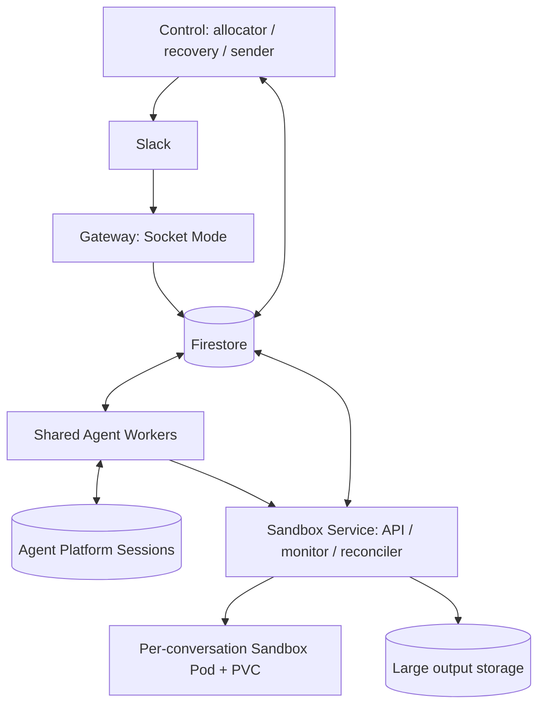
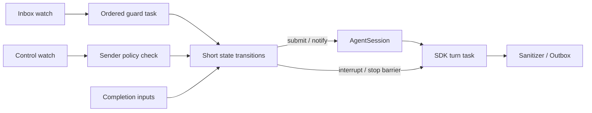
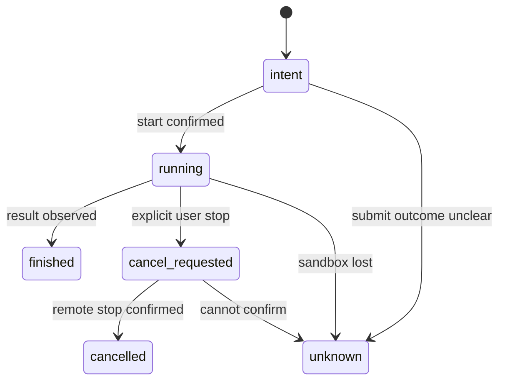
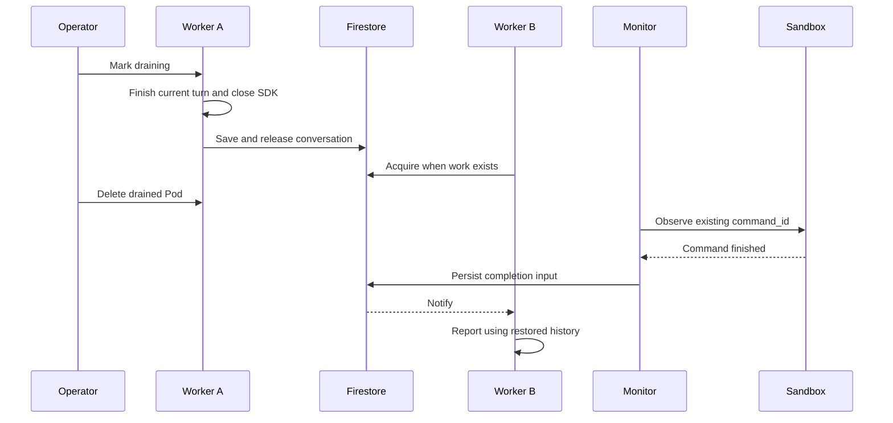

# Design

## Context

動機は [proposal.md](proposal.md)、議論の詳細は [distribution-plan.md](../../../docs/distribution-plan.md) を参照する。採用構成は共有 Worker と別 Pod の Sandbox。SDK/Sandbox の同居と会話ごとの Worker Pod は採用しない。

確認済みの実装:

| 箇所 | 現状と変更理由 |
| --- | --- |
| `core/session.py` | Registry の asyncio.Lock はプロセス内限定。submit/notify は実行中の Engine に append し、それ以外はメモリ queue に積む |
| `agent/engine.py` | `_sent / _echoed / _closing` で終了間際の追記を処理。これは維持する |
| `core/orchestrator.py` | guard が非同期で、履歴・開始者ロックはメモリ内。停止とガード完了の順序を分散環境で定義する必要がある |
| `channels/slack.py` | listener が task を作って戻るため ACK と永続化の順番を保証しない |
| `channels/slack_events.py` | RecentIds と参加スレッドのキャッシュが単一プロセス前提 |
| `core/background.py` | 完了通知はメモリ task と callback。再起動で追跡が失われる |
| `sandbox/gke.py` | start と wait は分離済み。ただし wait の CancelledError で明示 cancel を送る |
| `gke_session_sandbox/commands.py` | command_id 指定の start/get/wait/read_output/cancel を提供。wait は状態のポーリング |
| `core/lifecycle.py` | 他の bot_instance_id の running をすべて中断扱いにする |
| `stores/state.py` | append-only の管理ログとプロセスローカル cache。競合更新に使えない |
| `gke_session_sandbox/manager.py` | SQLiteSessionRepository 具体型を使用。Repository port が必要 |
| `gke_session_sandbox/reconciler.py` | 全件走査、起動時の file operation counter 初期化が単一 API process 前提 |
| `k8s/base/deployment.yaml` | replicas 1 / Recreate / SQLite RWO PVC |

既存テストの `test_session.py`、`test_claude_engine.py`、`test_background.py` を動作の基準にする。ただし `test_gke_runtime.py` の「wait 取消で remote cancel」という期待は本変更で意図的に変更する。

## Goals / Non-Goals

**Goals:**

- 通常稼働中の一会話を一つの SDK で処理し、別会話を Worker 間に分散する。
- SDK turn、Inbox 受付、停止、コマンド監視、Slack 送信が互いの完了待ちで止まらない。
- Worker の停止を Sandbox コマンドの停止から分離する。
- Firestore を共有制御状態の正本にし、SQLite に依存せずに複数サービスを動かす。
- Luna が段階的に実装できるよう、状態・API・競合時の判断・リリース条件を確定する。

**Non-Goals:**

- SDK のメモリ移送、foreground ツール待ちの透明な再接続、障害後の自律的な作業再開。
- すべての外部副作用の exactly-once。送信済みか不明なものは uncertain として止める。
- 本 change での HPA 自動縮退、リージョン/ゾーン冗長化、Cloud Run/Pub/Sub 導入。
- Sandbox 自体が失われた後のプロセス継続。PVC が守るのはファイルである。

## Decisions

### D1. 配置と責務

同一イメージから `silk-agent gateway|worker|control|sandbox-service --config ...` を起動する。既存 `silk-agent slack` と Streamlit はローカル/in-process 開発経路として残すが、分散配置と同じ会話データへ同時接続させない。初期 replicas は役割ごとに1、Worker は2台で受け入れ確認する。Control 内の役割は別 task、Sandbox Service 内の監視も API のリクエスト寿命から独立する。

GKE と同リージョンの Firestore Native mode Standard edition を使う。常時稼働する DB を追加しないため Cloud SQL/Redis は初期案から外した。Firestore watch と再照会で配送し、Pub/Sub の二重永続化問題を増やさない。参考料金と公式ソースは distribution-plan.md に集約する。

SDK は現在の trusted 側の権限で動かし、Sandbox の Egress/ServiceAccount を拡張しない。SDK を Sandbox と同一 Pod にするとネットワーク・認証境界が共有されるため採用しない。

### D2. モジュールと port

新規ファイルの推奨配置（実装で同等の責務に分割してよい）:

| 配置 | 内容 |
| --- | --- |
| `core/distributed_models.py` / `core/distributed_ports.py` | Envelope、OwnershipToken、CommandExecution、DeliveryState と永続操作の Protocol |
| `stores/firestore/` | クライアント生成、transactions、Inbox、所有権、commands、outbox、watch adapter |
| `distributed/gateway.py` | Socket envelope を永続化して ACK。SDK は起動しない |
| `distributed/worker.py` / `dispatcher.py` | 割当 watch、会話 actor、通常入力/制御の独立 task、SDK lifecycle |
| `distributed/control.py` / `recovery.py` / `sender.py` | 割当、失効回収、Slack 配送 |
| `sandbox/service.py` / `remote.py` / `monitor.py` | 内部 API、Worker 側 SandboxRuntime adapter、永続コマンド監視 |
| `gke_session_sandbox/repository_port.py` / `firestore_repository.py` | 既存 Repository の抽象化と Firestore adapter |
| `distributed/admin.py` / `migration.py` | drain 状態操作、データ移行と検証 |

Firestore の get/put 全体上書きだけを既存 SessionStateStore に差し込む実装は禁止。SDK 状態、進捗、コマンド、所有権は別々の更新主体を持つ。`commit_turn_state(token, expected_version, patch)`、`advance_input(...)`、`complete_command_and_enqueue(...)` のように、不変条件を守る操作を port に表す。ローカル経路向けには従来 store の adapter を維持する。

### D3. 永続状態と識別子

すべてのレコードに `schema_version` を持たせる。UTC timestamp を使い、fake Clock で試験可能にする。ユーザが指定した文字列をドキュメント path に直接使わない。

| 保存先 | 必須フィールド・役割 |
| --- | --- |
| `conversations/{keyHash}` | conversation_key、participating、owner_user/email、conversation_generation、sdk_session_id、turn_id/status、next_input_seq、stop_seq、allocation_state、version |
| `ownership/{keyHash}` | worker_id、worker_incarnation、epoch、lease_expires_at、phase（assigned/active/recovering/released） |
| `conversations/{keyHash}/inputs/{inputId}` | kind、seq、source_event_id、generation、payload、guard_decision、delivery_state、turn_id、dispatch_attempt_id、command_id |
| `conversations/{keyHash}/controls/{inputId}` | kind、seq、generation、sender、authorization_state、status |
| `slack_receipts/{hash}` | kind（event/message）、team/channel/ts または event_id、input_id、expire_at |
| `commands/{id}` | conversation_key/hash、generation（会話/Sandbox）、origin_turn、origin_epoch、origin_seq、request_hash、state、delivery_mode、notification_state、cancel_requested、output_cursor/ref |
| `sandboxes/{keyHash}` と notices サブコレクション | 現行 SessionRecord の互換データ、resource_version、操作世代、desired state、Pod/PVC、環境 fingerprint、期限 |
| `resource_leases/{id}` | 制御役割・Sandbox 操作・監視の所有者、epoch、期限 |
| `outbox/{id}` | conversation、turn、sequence、generation、epoch、kind、sanitized_payload/ref、status、attempt_id、Slack ref |
| `workers/{id}` | incarnation（Pod UID + 起動 UUID）、draining、capacity、reserved、active_sdk、heartbeat |

SDK session_id は新規 query の前に保存できる経路を用意し、ResultMessage で初めて記録することに依存しない。履歴保存警告は `history_uncertain` として引継ぎ時に確認する。

入力状態は `pending -> dispatching -> queued -> accepted -> completed` とし、`blocked / cancelled / suppressed / uncertain` を終端または人の再開待ちとして区別する。`queued` はメモリqueueに渡しただけで、Worker交代後に再投入できる。`accepted` はSDK turn開始またはappend受理を表し、query結果不明時は再送せず `uncertain` として調査する。append拒否なら `pending` に戻す。accepted と completed は同義でない。

必要な検索と index: 割当待ち会話、worker_id 別 ownership、期限切れ ownership、会話内の状態+seq、非終端 commands の次回確認時刻、pending outbox の会話+sequence、Sandbox の状態+期限。本文・出力・環境値の不要な index は無効にする。巨大配列を親 document に蓄積しない。処理済み子 document の保持期限は設定可能とし、未処理・uncertain は TTL で削除しない。

### D4. Gateway と ACK

受信トランザクションは event receipt と message receipt を検査し、会話内 seq を採番して input/control と receipt を一緒に保存する。通常投稿の message receipt は team/channel/ts を含め、mention と message の二重配送を排除する。重複なら保存済みを確認して ACK だけ返す。

ACK 前に Gemini、users.info、Sandbox 起動は呼ばない。受信 payload を保存してから Gateway/Control の独立した enrichment task で users.info を解決し、検証済み sender 情報を保存する。未解決状態も永続化し再起動後に回収する。Worker はその情報でポリシーを判定し、Slack token を持たない。通常入力と制御要求の enrichment は独立して進め、通常入力の遅延で停止候補を待たせない。停止語候補は同時に control として記録するが、許可確認前に停止境界を進めない。許可外のイベントも必要な監査後に filtered として終端化する。参加スレッドの判断は共有状態を使い、未参加 message を早期に重複排除済みにして後続 mention を消さない。

現行 Bolt の自動 ACK を前提にせず、SocketModeClient の envelope handler で「transaction commit -> send SocketModeResponse」を明示する。ネットワーク結果不明なら同じ受信 ID で照合する。保存前失敗は ACK しない。Slack の再送期間を越える障害に対する無損失保証は行わず、受付障害を監視する。

### D5. 所有権・旧 Worker の停止確認

Control の allocator は役割 lease を取得し、空きのある非 draining Worker を選ぶ。会話割当と予約数を同一 transaction で更新する。Worker は assigned を active に変えてから Registry に会話を作る。旧 Worker の解放時に SDK.close を終えてから released を記録する。

初期設定は lease 60秒、更新20秒、時計ずれ余裕5秒、SDK 上限4/Worker、idle close 600秒。lease は入力 document と分けて watch の更新費用を抑える。時刻取得失敗時は自分の推定で lease を延長しない。期限前に受付を停止するが、安全性は clock だけに依存させない。

失効時は直ちに次 SDK を起動せず、ownership を recovering にする。旧 incarnation に quiesce を要求し、SDK 停止済みの応答が得られれば引き継ぐ。応答不能なら旧 Worker Pod UID の終了を確認する。ノード到達不能や Pod の force delete だけで実プロセス停止を証明できない場合は recovery_blocked とし、新 SDK は起動しない。手動の node fencing 等で停止を確認して解除する。可用性より単一実行を優先する。

Sandbox API は要求の ownership epoch・会話世代・停止境界を読み、受理 intent を transaction で確定する。受理済み操作は command/op ID で監視し、lease 失効で勝手に再送しない。最終的な Sandbox mutation の並行受理は resource lease と generation の gate で制御する。事前チェック直後に世代が変わる競合を、単なるチェック1回で解決したと見なさない。

外部 MCP は既存接続方式を維持し、世代 fencing を提供しない MCP に架空の保証を付けない。旧 SDK の停止確認を新 SDK 起動の条件とする。すでに外部サーバが受理した副作用は unknown として引き継ぎ、同じ操作を自動再実行しない。全 MCP proxy の新設は本変更の前提にしない。

### D6. Worker の会話 actor

watch callback は asyncio loop への signal だけを行う。複数 callback が同じ会話の SDK を直接呼ばない。再接続時に未処理の状態を読み直す。通常入力は永続 seq 順に guard を適用し、guard の history は承認済み入力から直前5件を復元する。

dispatcher が await するのは短い状態遷移のみ。SDK.run_turn、Sandbox.ensure、guard、stop 完了待ちは別 task とし、停止を阻害しない。SDK 操作の順序を会話単位で整え、stop pending を設定した後に新 query を送らない。query 送信と stop が競合した場合、送信の成否を記録し interrupt 対象に含める。

ユーザ停止は、認可後に `stop_seq` を transaction で進める。先行 input の無効化は個々を巨大 transaction で更新せず、まず barrier で即時適用し、表示用の cancelled 更新はページングする。SDK interrupt と command cancel は並行し、双方の結果を確認する。後続 seq は停止完了後に実行する。停止時点で動いている turn 全体を止めるため、その turn の開始 seq を command intent に持たせる。監視通知由来の turn も同じ順序体系に入れる。

reset は stop の完了後に conversation_generation を増やし、sdk_session_id と guard history をリセットする。Sandbox のファイルは従来どおり残す。旧世代の入力/通知/出力は抑止する。reset 要求より後の未処理ユーザ入力は新世代に結び直して処理し、旧世代のシステム通知とは区別する。

`AgentSession` の queue は scheduling の補助に限定し、未実行入力の正本は Inbox に残す。append / interrupt / queue と Engine の replay-user-messages を維持する。通常のツール waiting は最大20秒、明示 background は即時返却という契約を変えない。

### D7. Sandbox Service とコマンドの寿命

内部 API は aiohttp を利用し、認証済みの呼出し元と token の会話を照合する。各要求には request_id、conversation key、owner epoch、conversation generation、turn_id を付ける。Sandbox 世代は Service が正本から決める。

| 操作 | API 契約の例 |
| --- | --- |
| 準備・ready・通知 | POST session/ensure、GET session/status、GET notices、POST notice/ack |
| コマンド | POST commands（安定 ID）、GET command/status、GET command/output（cursor）、POST command/detach、POST command/cancel |
| ファイル | read/write/list 等。変更は operation ID、照会は上限付きページング |
| Skills | 世代と manifest で同期し、部分同期を ready と扱わない |

URL 名は実装時に整えてよいが、start と wait と cancel を一つの HTTP request 寿命に結びつけない。`remote.py` が現行 SandboxRuntime を満たす。Service Pod の再起動も cancel ではない。

開始は intent 保存 -> command_id を指定して tracker.start -> 応答記録。要求 ID と引数 hash が一致する再照会は同じコマンドを返し、異なる payload は conflict。送信後に応答が失われたら command_id を照会する。404 が一時的・別世代・本当に未実行のどれか確認できなければ unknown とし、自動再送しない。

Monitor は commands を lease で分担し、状態が変わったときだけ保存する。既存 tracker API の get/output を使う。foreground から background への detach と terminal 記録を transaction で調停し、結果をツールで返すか後から通知するかを一つに決める。

実行状態とは別に `delivery_mode=foreground|background|orphaned` と `notification_state=none|pending|delivered|suppressed|held` を持つ。detach/cancel は DB transaction の中で HTTP を呼ばない。

terminal 保存と `command-finished:{sandbox-generation}:{command-id}` の input 作成は同一 transaction。通知側でも cancellation と世代を再確認する。stop 後にすでに配信済みの Slack 投稿は取り消せない。未送信出力は turn/generation/stop barrier で抑止する。

Worker が失われた foreground コマンドは orphaned にする。完了後は結果を保持し、機械的な状態通知を sanitizer 経由で送る。元の SDK の tool response として無理に再注入しない。idle の正常会話の background 完了は SDK 通知 turn を開始する。interrupted の会話は通知を held にし、ユーザの resume で結果を渡す。

### D8. Sandbox Repository と lifecycle

現行 get/get_by_hash/create/CAS/reserve_command/event ack/operation count/lease を Protocol 化し、SQLite adapter のローカル利用は維持する。Firestore adapter は revision と lease token を transaction で検証する。分散配置では SQLite を使用しない。

ファイル操作の単一 counter を起動時に一括ゼロへ戻す方式を廃止し、operation ID と実行主体/期限を持つレコードで管理する。別 Service の実行中操作を起動時リカバリで消さない。複数 Service が同じ Sandbox を suspend/delete しないように resource lease を持つ。

Kubernetes と DB は原子的に更新できないため desired state と operation ID を先に記録し、決定的なリソース名・UID・generation を照合して収束させる。SDK turn の所在は Worker にあるが、既存の Sandbox 停止条件（active commands/file ops がないこと）を維持する。未知の実行状態なら停止しない。

### D9. Outbox と Slack 表示

sanitizer を通ったイベントのみ delivery-ready にする。生の内容が必要な監査 hooks は従来どおり別経路。失敗した出力検査を通過扱いにしない。長文・ファイルの検査とアップロードも維持する。

Sender は会話単位の lease で順序を守る。progress はその turn の最新 snapshot と Slack ref を保存し、heartbeat を coalesce する。完了後に古い heartbeat が表示を running に戻してはならない。

送信前に attempt_id を保存し、成功後に Slack ts を記録。通信結果不明は uncertain にし、新規投稿を無条件再送しない。特定の ts への同内容 update と新規 post を区別する。HTTP 429 は Retry-After と next_attempt_at で待機し、他会話や SDK を止めない。未送信終端状態の失効・停止抑止を送信直前に検査し、送信済み副作用を取り消せるとは保証しない。

### D10. 縮退と障害復旧

計画的 drain は SIGTERM より前に管理コマンドで開始する。新規割当を止め、既存会話の追記・停止は受け付ける。turn が idle になった会話から SDK 保存/close -> lease release の順で解放する。解放と新着入力は transaction で調停し、未処理入力があれば次 Worker への割当待ちにする。

drain の既定は待機（自動期限なし）。運用者が期限を指定した場合、期限後は SDK を中断して interrupted_shutdown を保存するがコマンドは detach する。SIGTERM の fallback grace は既存25秒を維持し、Pod の45秒猶予内で保存と終了を試みる。保存失敗は成功として release せず recovery 対象にする。

通常の Deployment scale-down が drain 済み Pod を選ぶ保証はない。初期の安全な手動縮退は Worker Deployment 全体を drain -> 全 Worker の reserved/active が0を確認 -> replicas を減らす -> 残存 Worker の drain を解除する手順にする。その間の新規入力は Inbox に保持する。将来の個別 Pod 選択や HPA drain controller は対象外。

Worker Pod の終了は Sandbox Pod の削除理由にしない。Sandbox の ownerReference は Worker を指さない。SDK.stop と remote.cancel の結合を解き、`user_stop/reset` と `drain/shutdown/lease_lost` を型で区別する。

### D11. 認証、運用、コスト

役割別 KSA と Workload Identity を用意し、Worker に Slack 投稿権限、Gateway に Sandbox 操作権限を配らない。Firestore server SDK の IAM はコレクション単位の細かい制御として扱わず、アプリの会話所有権検証を併用する。内部 API は projected KSA token を専用 audience で受け取り、TokenReview の結果と許可された KSA を検査する。NetworkPolicy は補助とする。Secret の値をログや CLI 引数に出さない。

測定対象は inbox 最古待ち時間、append/stop latency、completion-to-reply latency、active SDK、memory、lease renewal failure、recovery_blocked、uncertain input/output、Firestore operation 数。高カーディナリティの会話 ID は metric label にしない。

query/transaction の件数を計測し、全 Worker が全会話を秒ごとに読む方式を避ける。listener 再接続・transaction retry の費用も含めて評価する。プロジェクトの既存 Firestore database は Terraform で無断作成・置換しない。create/import/use-existing を設定で選べるようにする。

## Risks / Trade-offs

- [lease 失効しても旧プロセスが生存] → recovering と停止確認を導入。証明不能なら recovery_blocked。
- [SDK/Slack と DB の間でクラッシュ] → dispatch attempt を残して uncertain。自動再送しない。
- [共有 Worker の OOM が複数会話に影響] → 稼働 SDK 上限とメモリ指標。上限到達は割当待ちにする。
- [Control 停止で新規割当・出力が遅れる] → 永続状態と役割 lease で再起動可能にする。既存会話の停止は Control に依存させない。
- [単一ゾーン・Sandbox ノード障害] → 保証範囲を明示。稼働プロセスの保存とは扱わない。
- [仕様と現行テストの衝突] → shutdown remote cancel と全他起動ID recovery の期待を変更し、それ以外の回帰を維持。
- [スケールアウトしても一会話の速度は変わらない] → 会話間を分散する設計として説明し、同一会話の並列 SDK を作らない。

## Migration Plan

1. port と fake、Firestore emulator の試験経路を作り、単一 Worker で制御を完成させる。
2. Sandbox Service と永続 Monitor、受信/出力経路を接続してから2 Worker の障害試験を行う。
3. dry-run 移行ツールで SQLite と旧管理 Sessions の件数・キー・世代・Pod/PVC・owner 情報を比較する。
4. 本番切替は Gateway 受付を停止し旧 Bot/reconciler を止めてから一度だけ import。途中再実行は source version/hash で重複排除し、不一致を上書きしない。
5. SDK transcript と Sandbox PVC は再利用する。処理中コマンドは同じ ID で照会し、結果不明を再実行しない。
6. 分散構成を1 Workerから有効化し、2 Worker へ増やす。旧単一 Bot を同じ会話に接続しない。
7. ロールバックは切替前なら旧 snapshot を使用可能。切替後に新規入力を受けたら snapshot へ単純に戻さず、新構成を drain/停止して最新 Firestore 状態の整合性を確保する。旧版復帰には逆移行または履歴整合の手順を別途実行する。黙って入力を捨てる rollback はしない。

## Open Questions

- 実環境の Firestore DB 名と import の必要性。採用構成を変えず、deploy 前の preflight で確定する。
- Worker の実メモリから決める収容上限。初期値4を計測で調整する。
- watch 再接続・監視間隔の実負荷値。正しさは永続再照会で担保し、遅延と費用を測って調整する。
